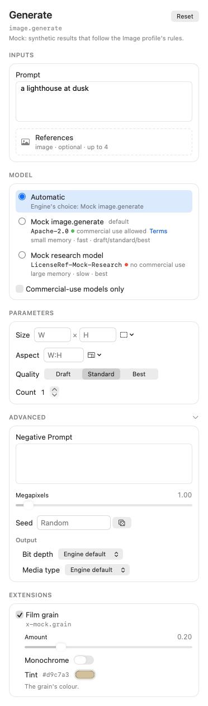
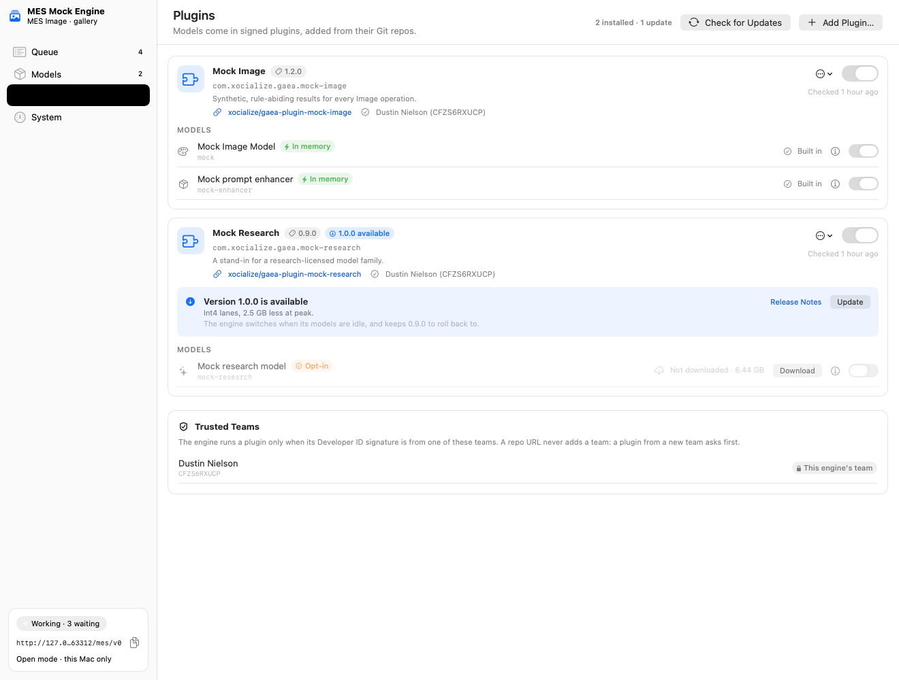
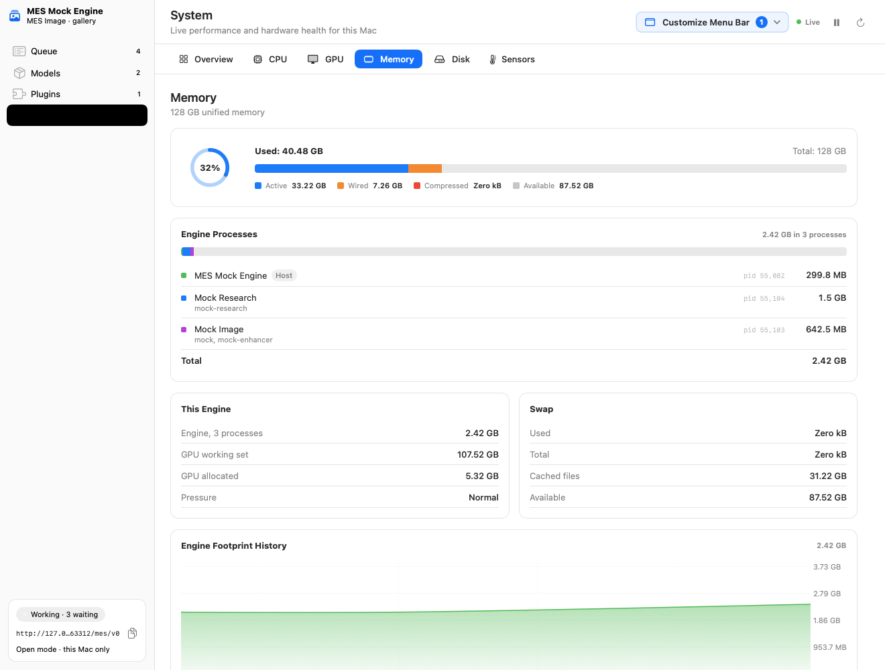

# Media Engine Specification (MES)

An open specification for talking to **media engines**: local or LAN services that run AI models on images, video
and other media. A client asks for an operation ("fill this masked region", "upscale this 2×"); the engine
normalizes how a specific model is used, and reports what it actually did. Any compliant client can use any
compliant engine, on any platform.

> **Status:** Base 0.1 and Image profile 0.1 are **drafts**, tagged `v0.1.0`. **MESKit works:** MESCore; the engine kit in
> open and paired modes (TLS, pairing, tokens, DNS-SD) with SSE, the WebSocket channel and the MCP binding; the client
> kit (discovery, pairing, jobs, events, grants, an engine picker for several servers) and an in-process transport; the `mes` CLI; MESFormsUI (SwiftUI forms
> from descriptors); the conformance suite for engines and clients; and a mock Image engine. The mock and `mes` both
> conform. **R0 is complete** ([build plan](docs/BUILD-PLAN.md)).

## Reference implementations

- **Gaea** is the reference engine: the production MES media server, one engine for the Image, Audio and Video profiles,
  whose models are signed plugins that each run in a process of their own. It is built on MESKit: MESEngineKit for the
  front end, and MESEngineUI and MESFormsUI for its menu bar and console, including the Plugins page and the System
  page's memory summed across its worker processes.
- **Gaea Lab** is the reference client, on MESClientKit and MESFormsUI. It is the client the client conformance suite
  (`mes-conformance client`) runs against, and it uses MESClientKit's engine picker to choose between several Gaea
  servers on a LAN.

Both are in development (Gaea's phase G0). Until they ship, the
[Pixel Agency Image Engine](https://github.com/xocialize/pixel-agency-image-engine), which passes the engine conformance
suite against real models, and [Pixel Agency Lite](https://github.com/xocialize/pixel-agency-lite) remain the working
implementations. Gaea replaces the Image Engine, and Gaea Lab replaces Lite as the reference client, taking over the
client conformance role before Lite is deprecated.

## Contents

| Path | What |
|---|---|
| [`spec/base.md`](spec/base.md) | **Base 0.1:**<br/>• discovery, pairing and descriptors;<br/>• model offers and their adapters (e.g. LoRA);<br/>• jobs, uploads, grants and events;<br/>• results, provenance (models, adapters, helpers) and licence policy;<br/>• retention guarantees, errors and the MCP binding. |
| [`spec/profiles/image.md`](spec/profiles/image.md) | **Image profile 0.1:** 15 operations (including `image.enhance_prompt`, a preview of a prompt rewrite, and `image.decompose`, an image as front-most-first RGBA layers), the shared vocabulary, conventions (sRGB, masks, alpha, prompt enhancement, adapter slots), warnings, conformance tests |
| [`schemas/v0/`](schemas/v0/) | JSON Schemas (draft 2020-12) for every Base message, the Image vocabulary, and the operations table |
| [`examples/v0/`](examples/v0/) | Realistic messages, each validated against its schema |
| [`tools/`](tools/) | `validate.py` (schemas + examples + profile rules, no dependencies), `test_validator.py` (negative tests), `make_examples.py` |
| [`Package.swift`](Package.swift), `Sources/`, `Tests/` | **MESKit:**<br/>• **MESCore:** types, a schema validator, the Image tables, the pairing code.<br/>• **MESEngineCore:** the engine core (jobs, spool, retention), no networking.<br/>• **MESEngineKit:** the engine side of Base on Hummingbird 2.<br/>• **MESClientKit:** the client side (discovery, pairing, jobs, events, grants).<br/>• **MESInProcess:** an in-process engine behind the client API.<br/>• **MESFormsUI:** SwiftUI forms rendered from descriptors, and `mes-forms-gallery`.<br/>• **MESEngineUI:** an engine app's own console (queue, enabled set of models, System monitor, menu-bar item), and `mes-console-gallery`.<br/>• **MESConformance:** the conformance suite and `mes-conformance`.<br/>• **`mes`:** the command-line client.<br/>• **MockEngineCore** and **`mes-mock-engine`.** |
| [`docs/BUILD-PLAN.md`](docs/BUILD-PLAN.md) | R0: the Swift SDKs, mock engine, conformance suite and `mes` CLI |
| [`docs/CONFORMANCE.md`](docs/CONFORMANCE.md) | The conformance catalogue: every BASE and IMAGE test, and how to run them |
| [`rfcs/`](rfcs/) | How changes are proposed |

## Checking the documents

```bash
python3 tools/validate.py
```

```bash
python3 tools/test_validator.py
```

## Running the mock engine

```bash
swift run mes-mock-engine --port 17600
```

```bash
curl -s http://127.0.0.1:17600/mes/v0/operations
```

Use it from an agent over MCP. Each operation is a tool (`image_generate`, `image_fill`, …):

```bash
claude mcp add --transport http mes-mock http://127.0.0.1:17600/mes/v0/mcp
```

Paired mode (TLS and pairing), approving each pairing at the prompt:

```bash
swift run mes-mock-engine --paired --approve prompt
```

The `mes` command-line client finds, pairs with and drives any engine:

```bash
swift run mes discover
```

```bash
swift run mes run image.generate -i prompt="a lighthouse at dusk" -p size=1024x768
```

```bash
tools/smoke-cli.sh
```

Adapters and prompt enhancement (Base §6.3, Image §1.9 and §3.1). Generate's mock offer takes three adapters, and
`prompt_enhance: on` rewrites the prompt and reports the rewrite. `image.enhance_prompt` previews a rewrite so a client can
show and edit it before running:

```bash
curl -s http://127.0.0.1:17600/mes/v0/jobs -H 'Content-Type: application/json' -d '{"operation": "image.generate", "inputs": {"prompt": "a lighthouse"}, "params": {"prompt_enhance": "on"}, "adapters": [{"id": "mock-style", "strength": 0.5}]}'
```

```bash
swift run mes run image.enhance_prompt -i prompt="a lighthouse" -p target_model=mock
```

MESFormsUI renders an operation's controls from its descriptor: parameters by UI hint, model offers with their
licences, and extensions. The gallery shows every mock operation's form, with the request it makes:

```bash
swift run mes-forms-gallery
```



MESEngineUI is an engine app's console, shared by every Pixel Agency engine (Engines-PRD ENG-9). An engine supplies an
`EngineConsoleBackend`: `MESEngineServer`'s operator API (every client's jobs, operator cancel, descriptor reload) and its
own catalog, downloads and memory. MESEngineUI supplies the rest:
- **Queue:** the job running now with its stage, step and elapsed time; what's waiting, in the order the slot takes it;
  recent results. Any job can be cancelled.
- **Models:** the engine's enabled set (`ModelEnablement`). Engines pick models themselves, by operation and tier, so the
  operator switches models on and off instead of loading them. Autoswitch shows what a request that names no model gets.
  Each model's card says what it does, how to name it (CLI, JSON, MCP), how to prompt it, its licence, its plugin and
  version, and its state on this Mac. Download fetches the weights without loading the model. An opt-in model asks for
  its terms to be accepted first, and runs only when named. The enabled set persists through a `ModelEnablementStore`:
  a JSON file by default, or the engine's own database.
- **Plugins** (for engines whose models come as plugins, such as Gaea; the engine attaches an `EnginePluginBackend`): add
  a plugin by its Git repo URL, see its version and whether a newer release exists, update it, roll it back, and switch
  the plugin or any of its models on and off. A plugin signed by a team the engine doesn't trust yet asks the operator
  first, and the trusted teams are listed and can be removed.
- **System:** live CPU, GPU, memory, disk and sensors, from Nativ's system monitor. The engine's footprint is this
  process, or a host and its worker processes (`EngineProcessSource`): one row per process and their total, each read
  with `proc_pid_rusage`, or supplied by the engine. The `SystemSensors` trait (on by default) reads temperatures, fans
  and power through private interfaces. An App Store build turns it off and keeps thermal pressure.
- **Menu bar:** the engine's icon with its active-job count, or live CPU, GPU and memory readings; its menu shows the running
  job, what's waiting and what's in memory.

The gallery runs it over the mock engine, with jobs arriving every few seconds. The mock's models come in two mock
plugins, and two real worker processes hold memory, so the Plugins page and the System page's per-process memory work
as they do in Gaea:

```bash
swift run mes-console-gallery
```





`--snapshot <dir>` renders the Plugins, Models and System pages offscreen, in light and dark, then quits:

```bash
swift run mes-console-gallery --snapshot /tmp/mes-console
```

A client that knows several engines, such as several Gaea servers on a LAN, chooses one for each job with
`EnginePicker`. It keeps the paired servers that offer the operation and the named model, prefers one with the model in
memory and a short queue, and lets the app pin a server:

```swift
let picker = EnginePicker(candidates: EngineCandidate.available(pairings: saved, discovered: found))
await picker.setPin(.prefer("eng_studio"))
let (engine, job) = try await picker.run(request)
```

Test an engine against the spec (the report lands in `mes-conformance-report/`):

```bash
swift run mes-conformance engine http://127.0.0.1:17600/mes/v0
```

Test a client against a scenario-mode mock engine (`mes` by default, or any CLI with `--command`):

```bash
swift run mes-conformance client
```

```bash
swift test
```

## Serving an engine from Swift

```swift
let server = MESEngineServer(engine: MyEngine(), configuration: config)
try await server.run { port in print("listening on \(port)") }
```

In an engine process, SIGTERM or SIGINT stops the server gracefully: requests in flight get
`config.shutdownGracePeriod` (5 s), then `run` returns. An app that embeds the server sets
`config.handlesShutdownSignals = false` and stops it by cancelling the task. Otherwise the signal stops only the
server, and the app keeps running without it.

## Licences

- **Code, schemas, examples and tools:** Apache-2.0 ([LICENSE](LICENSE)).
- **Specification prose** (`spec/`, `docs/`, `rfcs/`): CC-BY-4.0 ([LICENSE-docs.md](LICENSE-docs.md)).

## Relationship to Pixel Agency

MES is neutral. Gaea, Gaea Lab and Pixel Agency's apps (Desktop, Lite) are engines and clients like any other, with no
private extensions. The decisions behind the spec are in the Pixel Agency PRD set
(`ml(x)/PixelAgency/Docs/`, D-1, D-2, D-12).
