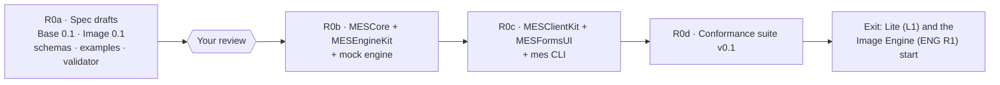

# MES R0 — build plan

| | |
|---|---|
| **Goal** | MES-PRD R0: a client written only from the spec documents drives an engine with no other knowledge of it |
| **Status** | R0a done (drafts in review). **R0b done** (R0b.1–R0b.3): open and paired modes, pairing, DNS-SD, the WebSocket channel, the MCP binding, mock engine. **R0c done** (R0c.1–R0c.3): MESClientKit, MESInProcess, the `mes` CLI and MESFormsUI. **R0d done:** the conformance suite: engines (`mes-conformance engine`; the mock conforms) and clients (`mes-conformance client`; the `mes` CLI conforms). 53 tests. **R0 is complete:** Lite (L1) and the Image Engine (ENG R1) can start. |
| **Source** | `ml(x)/PixelAgency/Docs/MES-PRD.md` §7.3 (deliverables DLV-1 to DLV-9) and §13 (phasing) |

## Steps

### R0a: specification drafts (done, in review)

| Deliverable | Where | Check |
|---|---|---|
| Base 0.1 | `spec/base.md` | Review |
| Image profile 0.1 | `spec/profiles/image.md` | Review |
| JSON Schemas | `schemas/v0/` (13 files) | `tools/validate.py`: every `$ref` resolves |
| Examples | `examples/v0/` (19 messages) | Each validates against its schema |
| Profile rules | `operations.json` + vocabulary | Descriptors may use only vocabulary parameters |
| Negative tests | `tools/test_validator.py` | 24 mutations, all rejected |

**Exit:** your review of the two documents. Changes are made in place while the version is 0.1.

### R0b: MESCore, MESEngineKit, mock engine

**R0b.1 (done, 2026-10-09):**
- **MESCore:**
  - Codable types for every schema.
  - A Swift JSON Schema subset validator, matching `tools/validate.py`.
  - The bundled Image operations table and vocabulary, kept identical to `schemas/v0` by a test.
  - The pairing code, matching an independent Python computation.
- **MESEngineKit** serves open mode (loopback only):
  - engine info, operations (with ETag), descriptors and health;
  - uploads: streamed, hashed, `Content-Digest` checked, single-use;
  - jobs: validation against descriptors, model choice by policy and tier, the run slot, wait, release, confirm;
  - ranged outputs, SSE with `Last-Event-ID` replay and heartbeat;
  - grants: same-host, no redirects, checksum checked;
  - the spool with the §13 rules: inputs gone after the run, outputs gone on confirm, release or TTL, crash sweep at
    start;
  - the origin guard, version negotiation, and §12 error bodies.
- **MockEngineCore / `mes-mock-engine`:** all 13 Image operations, with descriptors generated from the profile's own
  tables.

**R0b.1 tests:** 16 in all.
- **MESCore (6):** examples round-trip and validate in Swift, and the code agrees with the profile tables.
- **Engine (10):** every response is validated against the schemas, over live HTTP:
  - IMAGE-001 to IMAGE-004;
  - policy and validation refusals;
  - cancellation and slot hand-off;
  - TTL expiry, the crash sweep;
  - grants: good, wrong token, bad checksum, host rule.

**R0b.2 (done, 2026-10-09):**
- **`paired` mode:**
  - a self-signed P-256 TLS identity, kept in the state directory (never the spool);
  - the pairing endpoints (`POST pairings`, `POST pairings/{id}/confirm` with `Prefer: wait`, `DELETE pairings/self`);
  - the 6-digit code from both fingerprints, with operator approval through `pairingApproval`;
  - bearer tokens stored only as hashes, and per-client job ownership.
- **DNS-SD:** `_mes-engine._tcp` with the §3.1 TXT keys, advertised on the local machine only when the engine is
  loopback-bound.
- **`mes-mock-engine`:** `--paired`, `--approve prompt|auto`, `--state`, `--no-advertise`.
- **4 new tests,** 20 in all, over real TLS with a pinning URLSession client:
  - the same code on both screens, then tokens and ownership;
  - a declined pairing (403) and an undecided one (202);
  - unpairing (401);
  - a restart keeps the certificate and pairings, and a wrong pin is refused;
  - the TXT record.
- **Live:** `dns-sd -L` shows the TXT record, and the served certificate's fingerprint equals `tls.fingerprint_sha256`.

**R0b.3 (done, 2026-10-09):**
- **MCP binding (§15)** at `{path}/mcp`: swift-sdk 0.12.1 `Server` + `StatefulHTTPServerTransport`, one session per
  `Mcp-Session-Id`, bound to the client that opened it (paired tokens apply).
  - One tool per descriptor (`image.fill` → `image_fill`). The input schema is the descriptor's `params` with
    `x-` hints stripped, the inputs as data: URLs or `upload:<id>` (`data` inputs take the vocabulary's JSON),
    and `model` (an enum, each model's licence in the description), `wait_s` (0–300, default 50) and `policy`.
  - A call submits, waits with `notifications/progress` (0–100), and returns a text summary (model, licence,
    warnings, output URLs, expiry), an image preview (the output itself if PNG/JPEG ≤ 1 MB, else a ≤ 1024 px
    JPEG), a `resource_link` per output, and the Job as `structuredContent`. Failures are `isError` results
    carrying the §12 code.
  - Helpers `mes_list_operations`, `mes_get_job` (waits up to `wait_s` for the job to finish),
    `mes_cancel_job`, `mes_confirm_job`. Nothing is confirmed automatically.
- **WebSocket channel (§11)** at `{path}/ws`: subscribe to job ids (replayed from the first event) or `"*"`
  (the client's jobs plus `engine.health`, sent on subscribe and every heartbeat); unsubscribe; cancel; ping/pong;
  `error` frames. The upgrade runs through the same router, so the origin guard and paired auth apply.
- **`idleTimeout`** (default 60 s) closes keep-alive connections idle between requests.
- **Fixed:** `JobRegistry.waitForChange` awaited an unstructured deadline task inside its task group, so every
  long poll (`GET jobs/{id}?wait=`) ran to its full deadline even after the job changed.
- **Spec clarifications** (base.md §11, §15): `error` frames; replay on subscribe; duplicate delivery and
  `(job, seq)`; per-connection `seq` for engine events; refused upgrades are a 4xx; progress may arrive on the
  standalone GET stream.
- **8 new tests,** 28 in all: MCP through the swift-sdk client (tools from descriptors, generate with progress,
  preview and link, data-URL fill, tool errors, a job outliving `wait_s`, cancel); WebSocket through
  URLSessionWebSocketTask (`"*"`, replay and cancel, origin refused, paired tokens and ownership); idle timeout.
- **Live:** `curl` MCP handshake → 17 tools → `image_generate` result; `101 Switching Protocols` on `{path}/ws`.
- **Known gaps:**
  - swift-sdk 0.12.1 routes every server notification to the standalone GET stream, so progress reaches only
    clients that open it (Claude Code and the swift-sdk client with `streaming: true` do).
  - ~~hummingbird-websocket adds its idle timer only after the upgrade decision, which needs a complete request
    head, so a client that never finishes its head holds its connection.~~ **Fixed 2026-10-09 (AB-T-0211):**
    `requestHeadTimeout` (default 10 s). See the hardening note below R0c.3.
  - A refused upgrade answers 400 (hummingbird-websocket's failed-upgrade path), not the 403 a plain request gets.

One Swift package, `MESKit`, in this repo. Its products:

| Product | Contents | Builds on |
|---|---|---|
| **MESCore** | `Codable` types for every schema; the vocabulary; the operations table; validation helpers. No networking. | Foundation |
| **MESEngineKit** | The engine side of Base: • HTTP routes (engine info, operations, jobs, uploads, outputs, confirm, health); • SSE with `Last-Event-ID` and a 15 s heartbeat; WebSocket; • spool and retention sweeper (§13), including the crash sweep; • pairing (P-256 keys, the HMAC code); `open` mode, loopback only; • the origin guard; DNS-SD advertisement; the MCP binding. Engine authors implement one protocol: `operations` plus `run(job)`. | Hummingbird 2 (the ML[X] Image Server runs 2.27) and hummingbird-websocket; swift-sdk (MCP) 0.12.x; CryptoKit; `dns_sd` (the Image Server's `Bonjour.swift` approach) |
| **MockEngine** (executable) | Offers all 13 Image operations with synthetic but rule-abiding results. For example, `fill` changes only the white-mask pixels, `upscale` is exactly ×scale, and `describe` returns canned JSON. Deterministic per seed. | MESEngineKit |

**Exit:**
1. The mock engine passes the Base and Image rules it can be tested on with `curl` and SSE.
2. Its descriptors and messages validate against `schemas/v0` (a test in the package runs the same examples).
3. A crash test (kill during `running`) leaves no spooled media after relaunch.

### R0c: MESClientKit, MESFormsUI, `mes` CLI

| Product | Contents | Builds on |
|---|---|---|
| **MESClientKit** | The client side of Base: • discovery (NWBrowser) and pairing, with pinned TLS through the URLSession delegate; • descriptors (with ETag), jobs, uploads, outputs, confirm and release; • SSE and WebSocket events as `AsyncSequence`s; • `Retry-After`, idempotency keys, and an optional grant server for custody-keeping clients; • a pluggable transport, so an app can register an **in-process engine** (Desktop's built-in ForgeCore, DESK:RUN-9). | Foundation, Network |
| **MESFormsUI** | SwiftUI forms from descriptor `params`, following the `x-mes-ui` hints: • widgets: enum → picker, bounded number → slider or stepper, seed → seed field, `size` → size field, string → text or textarea, boolean → toggle; • groups, order and advanced sections; • model offers shown with their licence; • extensions shown as an optional section. | SwiftUI, DesignScaffold tokens |
| **`mes` CLI** | `discover`, `pair`, `ops`, `run <operation> --input name=file --param k=v`, `jobs`, `get`, `confirm`, `release` | MESClientKit, swift-argument-parser |

**Exit:** `mes run image.fill` against the mock engine works end to end, from discovery and pairing through confirm,
and a MESFormsUI preview renders every mock descriptor.

**R0c.1 (done, 2026-10-09): MESClientKit and MESInProcess.**
- **`MESEngineCore` split out of MESEngineKit.** It holds `MediaEngine`, the job registry, the spool and
  retention, grant fetching and `EngineConfiguration`, with no networking stack. Cross-module internals are
  `package`. MESEngineKit re-exports it, and MockEngineCore now depends only on it.
- **MESClientKit** (Foundation, CryptoKit and Network only, so Lite stays light):
  - `EngineConnection`, the transport-neutral client protocol, with `run`, `follow`, `input(contentsOf:)`
    (inline under the engine's limit, else upload) and `downloadAll`.
  - `HTTPEngineConnection`:
    - open mode, or paired with the engine certificate pinned (SHA-256 of the DER) and a bearer token;
    - `MES-Version` on every request;
    - retries `busy` and `no_capacity` per `Retry-After`;
    - an `operations` ETag cache;
    - uploads carry `Content-Digest`, and downloads are checked against the output's SHA-256;
    - SSE parsed byte by byte (`AsyncBytes.lines` drops the blank lines that end events), resuming with
      `Last-Event-ID`;
    - errors are `MESClientError.engine(MESError, status, retryAfter)`.
  - `EventChannel`: the WebSocket client, with subscribe, unsubscribe, cancel, ping, and messages as events,
    pong or error.
  - `Pairing`: `begin` trusts the certificate on first use, checks it against `tls.fingerprint_sha256`, sends
    the key and nonce, and computes the code. `confirm(wait:)` returns approved or awaiting. `unpair`.
    `ClientIdentity` and the persistable `PairedEngine` support it.
  - `EngineBrowser` and `DiscoveredEngine`: NWBrowser with TXT parsing; `resolve()` returns a base URL.
  - `GrantServer`: a GET-only HTTP listener on Network.framework, with a random bearer token per grant, the
    SHA-256 and size in the grant, and `revoke`.
- **MESInProcess:** `InProcessEngine`, the same `EngineConnection` over the job registry with no sockets, for
  Desktop's built-in ForgeCore (DESK:RUN-9). Errors map to the same `MESClientError` statuses.
- **Found and fixed:**
  - NWBrowser doesn't report services on the DNS-SD local-only pseudo-interface. Loopback engines now register
    on `lo0` (still this machine only), and base.md §3.1 says SHOULD.
  - Resolved addresses describe themselves as `127.0.0.1%lo0`, so URL hosts are now formatted from raw bytes.
- **9 new tests, 37 in all.** They cover:
  - fill end to end (upload and inline inputs, events, a checked download, confirm, then 410);
  - §12 errors, `busy` with `Retry-After`, and idempotency;
  - SSE resume after a given seq;
  - the event channel;
  - a grant served and fetched, with a wrong token (401) and revocation (404);
  - DNS-SD discovery and resolve;
  - pairing (the same code, the pinned connection, `wss`, a wrong pin, unpair, decline);
  - in-process generate, upscale and errors.

**R0c.2 (done, 2026-10-09): the `mes` CLI** (swift-argument-parser, on MESClientKit only).
- **Commands:**
  - `discover`, `pair`, `unpair`, `engines`;
  - `info`, `ops`, `describe <operation>`;
  - `run <operation> -i name=value… -p name=value…` with `--model`, `--commercial-only`, `--allow-remote`,
    `-o`, `--no-confirm` and `--json`;
  - `jobs`, `get`, `download`, `confirm`, `release`.
- **Engine choice:** `--engine` takes a URL, or a paired or discovered engine's id or name. The default is
  `$MES_ENGINE`, then the only paired engine, then the only engine discovered. A paired engine found by discovery
  keeps its pin at its new address.
- **Inputs follow the descriptor.** Text is taken as is, media as file paths (inline under the engine's limit, else
  uploaded), and data as JSON. Repeating a name gives several values. Parameters are JSON when they parse, and
  `size` also takes `WxH`.
- **State:** the client identity (P-256 key, 0600) and pairings live in `--state-dir`, `$MES_HOME` or
  `~/Library/Application Support/mes`.
- **Exit check:** `tools/smoke-cli.sh` runs a paired loopback mock that approves automatically. The run goes
  discover → pair by name → `generate` → `matte` (on the generated image) → `fill` (image plus the matte's mask)
  → `jobs` → `download` (byte-identical) → `confirm` → `unpair` (afterwards `ops` is refused).

**R0c.3 (done, 2026-10-09): MESFormsUI** (SwiftUI and DesignScaffold 0.25: tokens, `SectionHeader`,
`cardSurface`, `LabeledSlider`). R0c's exit criteria are met.
- **Schema to widget.** The `x-mes-ui` hint picks the widget when it fits the schema; otherwise the schema's
  shape decides. Supported widgets:
  - picker (segmented when there are ≤ 4 short options with a default; otherwise a menu with an
    "engine default" entry);
  - multi-select, toggle, slider, stepper, seed (with a dice button; empty means random), size (W × H with
    presets), aspect, colour (`#rrggbb`), text and textarea, integer and number;
  - nested objects; `oneOf` variants (pick one, then edit its fields, which start out valid);
  - a JSON fallback.

  Without order hints, required properties keep the schema's order.
- **`OperationFormModel`** (`@Observable`):
  - values are set by path, and clearing the last nested value removes the object;
  - only values the person set are sent;
  - text inputs; a model choice and policy;
  - extensions, which start from their defaults;
  - validation issues mapped to the top-level field;
  - `missingInputs` and `request(media:)`.
- **Views:**
  - `OperationForm` and `OperationFormContent`: inputs (text areas, plus host-supplied media slots), model
    offers each with a `LicenseLine` (SPDX, a commercial-use dot, a Terms link), the commercial-only and
    remote-allowed toggles, parameters by group, a collapsible Advanced section, and Extensions.
  - Model rows aren't buttons, so the Terms link works inside them.
- **`mes-forms-gallery`:** in a window, an operations sidebar, the form, and the live `JobRequest`.
  `--snapshot <dir>` writes every mock descriptor's form as PNG, light and dark, with advanced fields,
  extensions and `oneOf` variants open (examples in `docs/images/`).
- **Mock:** `image.generate` declares an `x-mock.grain` extension (slider, toggle, colour) and records it in
  `effective.extensions`.
- **Found and fixed:**
  - Flexible-height text editors made fitting sizes wrong, so textareas are now a fixed 64 pt.
  - AppKit clamps windows to the screen, so a taller form was cropped in snapshots; the snapshot window opts
    out.
  - `app.run()` inside an async main's main-actor job never services the main queue, so the gallery's
    top-level code is synchronous.
  - `cacheDisplay` doesn't draw vibrancy materials. Check the live window with `screencapture -l`.
- **7 new tests, 44 in all:**
  - every field of every mock descriptor and of its extension gets a real widget (never the JSON fallback);
  - hint and schema mapping, order and labels;
  - paths and issues;
  - `oneOf` initial values validate;
  - extension defaults and the policy's model exclusion;
  - **every mock descriptor's default form makes a request the in-process engine accepts and runs (13 of
    13)**;
  - edited values (size, seed, quality, an extension, a canvas variant) reach the engine.

**Hardening (done, 2026-10-09, AB-T-0211): the first-request-head deadline.**
- **The fix:** `HeadDeadlineHandler` sits at the front of every connection's pipeline. It closes the connection
  `requestHeadTimeout` (default 10 s) after it opens, unless the pipeline has made its decision by then: either
  Hummingbird's `HTTPConnectionStateHandler` is present (a head was parsed, and the idle timeout takes over) or
  NIO's `WebSocketFrameEncoder` is (the connection upgraded, and pings take over).
- **What it covers:** silent clients, slowloris, malformed heads that stop the parser, and TLS handshakes that
  never start or finish.
- **How it's built:** the server channel is now composed from public types (`HTTP1WebSocketUpgradeChannel`, then
  `TLSChannel`, then `HeadDeadlineChannel`). Hummingbird keeps `HTTPServerBuilder.buildChildChannel`
  package-internal, so an existing builder can't be wrapped.
- **Verified:**
  - 2 new tests, 46 in all. With a 1 s deadline: a silent connection, half a head, and a malformed head with a
    body all close in under 3 s, while an upgraded socket answers pings after 1.6 s and a 3 s long poll
    completes. In paired mode, a connection that never starts TLS closes, and a real client still connects.
  - Live on `mes-mock-engine`: the silent, half-head and malformed connections closed at 10.0 s; a clean
    keep-alive connection stays open under the 60 s idle timeout. Before the fix, all of them were open
    indefinitely.

### R0d: conformance suite v0.1

| Product | Contents |
|---|---|
| **`mes-conformance engine <url>`** | Runs the BASE-nnn and IMAGE-nnn tests, for the features and operations the engine claims, and writes a JSON + Markdown report. Retention is checked by observation: for example, 410 after confirm, and nothing reachable after TTL. |
| **`mes-conformance client`** | Runs the mock engine in scenario mode (errors, `Retry-After`, slow jobs, expiries) and checks a client's behaviour from its requests. |

**Exit:** the mock engine passes all its tests, and the `mes` CLI passes the client tests. R0 is then done, and Lite
(L1) and the Image Engine (ENG R1) can start.

**R0d.1 (done, 2026-10-09): engine conformance.**
- **The catalogue:** [`docs/CONFORMANCE.md`](CONFORMANCE.md), generated by `mes-conformance list`. It has 29 BASE
  tests:
  - the handshake, versioning, the origin guard;
  - paired auth and TLS identity;
  - descriptors and their ETag;
  - the job lifecycle, request errors, idempotency, long polls, job lists;
  - outputs (ETag, byte ranges), confirm and release (410);
  - uploads (digest, single use), grants (bearer, wrong SHA-256);
  - SSE (framing, resume), WebSocket;
  - health, retention limits and observed expiry;
  - MCP tools, pairing.

  And IMAGE-001 to IMAGE-009. IMAGE-009 (descriptors match the operations table) codifies the profile's existing
  prose; spec/profiles/image.md §5 now lists it.
- **Gating:** each test runs only when it applies (a claimed feature, the mode, an offered operation). Otherwise it's
  skipped with a reason.
- **Probing:** the probes speak raw HTTP (the `Wire`, with certificate pinning and no URL cache), not MESClientKit,
  so statuses, headers and framing are what's tested.
- **Media:** test images are made in memory (an sRGB gradient, a grey mask, an EXIF-rotated JPEG, a Display P3 PNG).
  Outputs are decoded to pixels.
- **Schemas:** bundled from `schemas/` (`tools/sync-schemas.sh`; a test keeps the copies identical).
- **`mes-conformance engine <url>`:** open mode, `--pair` (pairs as part of the run, then BASE-090 unpairs at the
  end), `--paired-state` (a `mes pair`), or `--token` with `--pin`. Also `--only`, `--max-ttl-wait` and
  `--grant-host`. It writes `report.json` and `report.md`, and exits 0 when the engine conforms.
- **Found and fixed:**
  - **The engine (and §7.3):** `?wait` on a job already holding waited for the next change, which is its expiry.
    So a client polling just after completion stalled for the whole wait. Held and purged jobs now answer at once.
    The full suite against the mock dropped from 72 s to 3 s, and the engine tests from 25 s to 20 s.
  - **Wire and client kit:** URLSession's URL cache answered the engine's 304 as a cached 200. Both the suite's
    wire and MESClientKit now run without a URL cache.
  - **§7.1:** a request that breaks its descriptor's structure (a required input missing, fewer values than
    `min`, mutually exclusive parameters) is 400 `invalid_request`; 422 is for well-formed requests the engine
    can't accept. This is the line the engine and IMAGE-008 already drew.
  - **Stricter Image checks:** IMAGE-005 also requires upright outputs with no orientation flag (§1.4), and
    IMAGE-006 requires the output to be tagged sRGB (§1.3). The mock passes both.
- **Verified:**
  - 5 new tests, 51 in all:
    - the mock in open mode: every applicable test passes, with BASE-005, 006, 071 and 090 skipped with their
      reasons;
    - observed expiry (BASE-071 alone with a 3 s TTL);
    - paired mode with `--pair`: everything passes, BASE-005, 006, 052, 080 and 090 included;
    - **a deliberately broken engine fails exactly IMAGE-001 and IMAGE-002**, and Base still conforms;
    - the bundled schemas are the repo's.
  - Live CLI against `mes-mock-engine`: open mode 34 passed, 0 failed, 4 skipped; paired with `--pair` 37 passed,
    0 failed, 1 skipped (BASE-071, at a 3600 s TTL).

**R0d.2 (done, 2026-10-09): client conformance. R0 is complete.**
- **Scenario mode:** `EngineConfiguration.interceptor` sees every request first, with its body, and may answer it
  instead of the engine. `responseObserver` sees every final status. Both are documented as being for conformance
  scenarios and debugging, and are nil in production. `logLevel` quiets short-lived engines.
- **`mes-conformance client`:** seven scenarios, each a fresh mock engine on loopback:
  - `normal` (about a second, with progress);
  - `busy` (429, Retry-After: 2) and `no-capacity` (503, Retry-After: 2);
  - `failed`, and `cancelled` (the suite, acting as the engine's operator, cancels the job while it runs);
  - `unknown-error` (a 422 with a code from a future spec);
  - `gone` (outputs answer 410).

  The client does one task per scenario and is judged from the engine's side: the recorded requests and their
  timing, the jobs it left holding, its exit status. That gives eleven checks, CLIENT-001 to CLIENT-023 (see
  [CONFORMANCE.md](CONFORMANCE.md)). SHOULDs, such as sending `MES-Version` or reusing an Idempotency-Key, are
  reported as notes, not failures.
- **Clients under test:** the default is `mes`, the executable beside `mes-conformance`. `--command` takes any
  command-line client as a shell template with `{url}`, `{prompt}` and `{out}`. The run writes
  `client-report.json` and `client-report.md`.
- **BASE-002 tightened:** the engine MUST echo `MES-Version` on responses (§2 rule 4), and now the test requires it.
  `MES-Request-Id` is a SHOULD, reported as a note.
- **Verified:**
  - 2 new tests, 53 in all. **The `mes` CLI passes all 11 client checks** in about 9 s, which is the R0d exit.
  - A naive curl client (polls in a tight loop, never confirms, ignores Retry-After, always exits 0) fails
    CLIENT-003, 004, 010, 011, 020, 021 and 022, and still passes 002 and 005 (its request is valid and it does
    fetch the output).
  - The client test needs `mes` built (`swift build --product mes`).

## Platforms and versions

- **Platform:** macOS 26+ and Swift 6 strict concurrency, matching the fleet. MESCore stays Foundation-only so a Linux
  build is possible later (MES-PRD OQ-5: Python kits come next for other platforms).
- **Dependencies:** pinned by tag, never by local path. The versions start from what the ML[X] Image Server proved:
  Hummingbird 2.27, swift-sdk 0.12.1, swift-argument-parser 1.5+.

## Publishing

Published 2026-10-10 as a public repository, [xocialize/media-engine-spec](https://github.com/xocialize/media-engine-spec)
(MES-PRD OQ-1), with the first tagged draft, `v0.1.0`: Base 0.1 and Image 0.1. Consumers depend on it by URL at a
tag.

Patch releases (MESKit only; the spec is unchanged):
- **`v0.1.1`** (2026-10-11): MESClientKit answers TLS trust at the task level, so event streams work on paired engines.
- **`v0.1.2`** (2026-10-11): SIGTERM ends an engine process promptly. `MESEngineServer.run` bounds the graceful stop
  (`EngineConfiguration.shutdownGracePeriod`, 5 s), so an open event stream or a slow upload no longer holds it up
  indefinitely. Apps that embed the server opt out of signal handling (`handlesShutdownSignals = false`).
- **`v0.1.3`** (2026-10-11): an `output` an operation doesn't offer, such as bit depth 16 where only 8 is offered, is
  refused with 422 `unsupported_parameter` as Image §1.2 says, not `out_of_limits` (AB-T-0231). New conformance test
  IMAGE-010 checks it.

Minor releases (Base 0.1 gains optional fields; old engines and clients still validate):
- **`v0.2.0`** (2026-10-18): a model offer MAY carry `notes`, short usage guidance such as prompting rules (Base §6
  rule 5; `ModelOffer.notes`, at most 1000 characters). The MCP binding's tool description now puts each offer's
  `license.notice` and `notes` on that model's line (Base §15), so an agent sees the terms and the guidance before it
  names the model; the `model` parameter keeps the short line. MESFormsUI shows notes as the model row's help
  (AB-A-0186).
- **`v0.4.0`** (2026-10-19; AB-A-0194, AB-D-0155; PRs #1 and #2): prompt enhancement and adapters. Base and Image
  stay 0.1 drafts; everything new is optional, except that an engine that rewrites prompts must now say so.
  - **Adapters** (Base §6.3): a model offer lists the adapters it takes (`adapters`, `max_adapters`: id, title,
    `plain` or `ic` with ordered `slots`, a strength range, a licence). A request asks for them by id
    (`adapters: [{id, strength?}]`), and an adapter implies its model. Provenance lists them with their licences and
    strengths, and `policy.license: commercial-use` covers them. MESEngineCore checks a request's adapters and chooses
    the model by them (`RunContext.adapters`); the MCP binding takes an `adapters` argument and lists each adapter under
    its model.
  - **Helpers** (Base §10.1): `provenance.helpers` names models that shaped a result without producing it, such as a
    prompt enhancer, with a role; the licence policy covers them too (`helper_skipped_by_policy`). Engines report them
    in `RunOutput.helpers`.
  - **Warning codes** (Base §10.1): an engine MAY use a code no registry defines; clients accept any code.
  - **Operations** (Base §6 rule 6): an engine offers only operations a profile defines.
  - **Prompt enhancement** (Image §1.9): `prompt_enhance` (`auto`, `on`, `off`) on every prompted operation. An engine
    that may rewrite a prompt declares it, warns `prompt_rewritten`, reports the text in `effective.prompt` (or
    `effective.instruction`), and names a separate enhancer in `provenance.helpers` (role `prompt_enhance`);
    `prompt_enhance_ignored` and `prompt_enhance_failed` say when it couldn't.
  - **`image.enhance_prompt`** (Image §3.1): the preview. It takes a prompt, the target operation and model, and
    returns `{prompt, applied, size?}` for the client to show and edit, then run with `prompt_enhance: off`.
  - **Adapter slots** (Image §1.10): an `ic` adapter's slots fill from `references` (generate) or `images` (edit).
  - **Conformance:** BASE-013, BASE-029 and IMAGE-011 to IMAGE-013. The mock offers all of it: three adapters on
    generate, `mock-enhancer`, and `prompt_enhance: on` rewrites.
  - **MCP progress, fixed** (Base §15): progress could be lost for a whole session.
    - The swift-sdk client sends its first standalone GET with the `Last-Event-ID` of initialize's priming event, and
      the transport then resumed that POST stream instead of opening the standalone one. The engine now drops a
      `Last-Event-ID` from a session's first GET.
    - Progress sent before the stream opens now waits and goes out once it does.
- **`v0.5.0`** (2026-10-27; AB-A-0207, Gaea G-7, G-14, G-16, G-18, G-19): MESKit for Gaea, a server whose models are
  plugins that each run in a process of their own. The spec is unchanged.
  - **MESEngineUI, Plugins page:** an engine attaches an `EnginePluginBackend` (`console.attach(backend, plugins:)`) and
    the console gains a Plugins section. Add a plugin by Git repo URL, see its version and a newer release, update it,
    roll it back, switch it or any of its models on and off, and remove it. A plugin signed by a team that isn't
    trusted yet comes back as `PluginInstallOutcome.needsTrust`, and the operator trusts the team or declines. The
    trusted teams are listed, and any but the engine's own can be removed. Types: `EnginePlugin`, `EngineTeam`,
    `EngineTrustedTeam`, `PluginTrustRequest`, `EngineUpdate`.
  - **MESEngineUI, System page across processes:** `SystemMonitorStore(processes:)` takes an `EngineProcessSource`:
    `.currentProcess` (the default, as before), `.processes` (the engine lists its host and worker pids, read with
    `proc_pid_rusage` `ri_phys_footprint`), or `.readings` (the engine supplies the numbers). The Memory tab shows one
    row per process and the total, and the footprint history is the total. `processSource` can be set after the engine
    starts its workers. `SystemTab` is public and the selected tab lives on the store (`store.tab`).
  - **`EngineModel`:** `plugin`, `version` and `update`. The Models page shows them, links a model to its plugin, and
    its Download action is documented as download without load (Gaea's GPP `materialize`).
  - **`ModelEnablement` behind `ModelEnablementStore`:** `init(store:)` loads from any store (Gaea's is its database)
    and throws what the store throws; `JSONFileEnablementStore` is the default and `init(file:)` is unchanged, as is the
    JSON.
  - **MESClientKit, `EnginePicker`:** for a client that knows several servers. Per job it keeps the candidates that
    offer the operation, the named model (or one that serves the requested tier) and the requested adapters, and that
    are reachable and not `unavailable`. It ranks the pinned server first, then by jobs ahead (waiting plus running),
    counting `loadPenalty` (2) more where the model isn't resident. `EnginePin.prefer` falls back and `.only` refuses.
    `EngineCandidate.available(pairings:discovered:)` keeps only paired engines that discovery sees.
  - **Galleries and tests:** `mes-console-gallery` puts the mock's models in two mock plugins and runs two real worker
    processes, so the Plugins page and the per-process System page work over the mock engine. `--snapshot <dir>`
    renders the pages offscreen. New tests: the picker against two live mock servers that offer different models, and
    a new MESEngineUITests target (the Plugins page model, process readings, enablement stores). 89 tests pass (72
    before); the mock engine still conforms (39 passed, 5 skipped in open mode) and so does `mes` (11 of 11).
  - **Source changes for consumers:** `ConsoleSection` gains `.plugins`, so an exhaustive `switch` over it needs a case.
    Iterate `console.sections` instead of `ConsoleSection.allCases`.
- **`v0.6.0`** (2026-10-30; AB-A-0228, [RFC 0004](../rfcs/0004-image-decompose.md) accepted, amended): `image.decompose`
  joins the Image 0.1 draft, for layer-decomposition models such as Ming-Image 0.1 Design-Layer (MLXEngine
  `layerDecompose`, contract 1.48.0). Additive; Base and Image stay 0.1 drafts.
  - **The operation** (Image §3.2): an `image` and an optional `prompt` (the layer plan, front-most first) in; `layers`
    out, front-most first with the background last, each straight-alpha RGBA at the input's size; `composite`, the
    model's own reconstruction, on request (`outputs: ["layers", "composite"]`).
  - **Vocabulary** (Image §2): `layer_count` (1–32, narrowed by the descriptor; exact, or refused), and `outputs` gains
    `decompose_outputs`. `effective.layer_count` is always reported. A count the prompt states meets the same rules.
  - **Refusals:** `layer_count` above the maximum is 422 `out_of_limits`; `outputs` without `layers` is 400
    `invalid_request`; an `outputs` value the descriptor doesn't list is 422 `unsupported_parameter`. That last one is
    a kit change that reaches `matte` too: MESEngineCore used to answer it `out_of_limits`. Schema errors on an array
    item now name the parameter (`outputs`), not the item (`outputs[1]`).
  - **Mock:** a background layer (the input) behind one vertical band per layer, up to 8, recomposing to the input
    exactly; the composite on request; `output` without JPEG. A plan's "Layer N" lines state a count.
  - **Conformance:** IMAGE-014 (count, size, alpha, `effective.layer_count`, the composite), IMAGE-015 (the refusals)
    and IMAGE-016 (the recomposition error, reported, never failed). IMAGE-010 now runs on the mock, against
    decompose's narrowed `output`. Examples: `operations-image-decompose.json`, `job-holding-decompose.json`.
    93 tests pass (89 before); `mes-mock-engine` conforms with 43 passed and 4 skipped in open mode (39 and 5
    before), IMAGE-016 reporting an error of 0.00/255; `mes` still passes 11 of 11 and `tools/smoke-cli.sh` end to end.
  - **Source changes for consumers:** `ImageProfile.operations` has 15 operations, and `ImageProfile.Param.layerCount`
    is new. A client or test that counted 14 operations, or switched exhaustively over the mock's operation ids, needs
    the new one.
- **`v0.6.1`** (2026-10-30; AB-A-0231, Gaea AB-T-0390): the suite is usable with slow but correct models. Ming-Image
  Design-Layer takes about 6 minutes for a 4-layer decompose at its 1024 bucket, and the suite waited 180 s per job, so
  IMAGE-003, -014 and -016 failed on a working engine, and IMAGE-004 failed queued behind them.
  - **`mes-conformance engine --job-timeout <s>`** (default 180; `Probe.Options.jobTimeout`): how long each job may
    run before its test fails. `run` and `settle` default to it, and the long poll waits no longer than the time left.
  - **A job that times out is released** (`DELETE jobs/{id}`), and the failure says so, so later tests don't queue
    behind it.
  - **Decompose is asked at `draft`** where the descriptor offers that tier and takes `quality` (IMAGE-003's decompose
    case, IMAGE-014, IMAGE-016): a probe needs the shape of the result, not its finish. Ming's draft is its 512
    bucket, about 1 minute.
  - **Tests:** a slow decompose fails at a 1 s job timeout and is released, then passes IMAGE-003, -014 and -016 at
    30 s, every run at `draft`. 94 tests pass (93 before). No spec or schema change.

## Next: the Audio profile

Drafting, from [`docs/AUDIO-EVALUATION.md`](AUDIO-EVALUATION.md) and RFCs 0001–0003. The profile has no schemas or
examples yet: `schemas/v0/profiles/` holds Image only.

- **TODO (A-10, 2026-10-24):** when `spec/profiles/audio.md` is drafted, add `schemas/v0/profiles/audio/operations.json`
  and `vocabulary.schema.json` covering `audio.compose` (evaluation §4.7: `caption`, `lyrics`, `score`, `reference`,
  `source`; `duration_s`, `language`, `planning`, `edit`, `anchors`, `timestamps`; outputs `song`, `score`,
  `timestamps`), and under `examples/v0/` a `job-request-compose.json`, an `operations-audio-compose.json` descriptor
  with the three offers of §4.7.5 (ACE-Step 1.5 default, YuE2-3B `named_only`, MiniMax Music 3 with its display
  notice), and a `job-holding-compose.json` showing `effective.duration_s`, `effective.anchors` and `song_truncated`.
  Base needs `supports` and per-offer `limits` on the offer schema first (RFC 0003), `min_duration_s` in limits, and
  `phase` and `media_s` on progress (evaluation §3.4).
