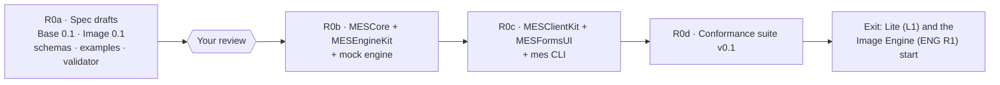

# MES R0 — build plan

| | |
|---|---|
| **Goal** | MES-PRD R0: a client written only from the spec documents drives an engine with no other knowledge of it |
| **Status** | R0a done (drafts in review). **R0b done** (R0b.1–R0b.3): open and paired modes, pairing, DNS-SD, the WebSocket channel, the MCP binding, mock engine. **R0c.1 done:** MESClientKit and MESInProcess; 37 tests. Next: the `mes` CLI (R0c.2), then MESFormsUI (R0c.3). |
| **Source** | `ml(x)/PixelAgency/Docs/MES-PRD.md` §7.3 (deliverables DLV-1 to DLV-9) and §13 (phasing) |

## Steps

### R0a: specification drafts (done, in review)

| Deliverable | Where | Check |
|---|---|---|
| Base 0.1 | `spec/base.md` | Review |
| Image profile 0.1 | `spec/profiles/image.md` | Review |
| JSON Schemas | `schemas/v0/` (13 files) | `tools/validate.py`: every `$ref` resolves |
| Examples | `examples/v0/` (19 messages) | Each validates against its schema |
| Profile rules | `operations.json` + vocabulary | Descriptors may use only vocabulary parameters |
| Negative tests | `tools/test_validator.py` | 24 mutations, all rejected |

**Exit:** your review of the two documents. Changes are made in place while the version is 0.1.

### R0b: MESCore, MESEngineKit, mock engine

**R0b.1 (done, 2026-10-09):**
- **MESCore:**
  - Codable types for every schema.
  - A Swift JSON Schema subset validator, matching `tools/validate.py`.
  - The bundled Image operations table and vocabulary, kept identical to `schemas/v0` by a test.
  - The pairing code, matching an independent Python computation.
- **MESEngineKit** serves open mode (loopback only):
  - engine info, operations (with ETag), descriptors and health;
  - uploads: streamed, hashed, `Content-Digest` checked, single-use;
  - jobs: validation against descriptors, model choice by policy and tier, the run slot, wait, release, confirm;
  - ranged outputs, SSE with `Last-Event-ID` replay and heartbeat;
  - grants: same-host, no redirects, checksum checked;
  - the spool with the §13 rules: inputs gone after the run, outputs gone on confirm, release or TTL, crash sweep at
    start;
  - the origin guard, version negotiation, and §12 error bodies.
- **MockEngineCore / `mes-mock-engine`:** all 13 Image operations, with descriptors generated from the profile's own
  tables.

**R0b.1 tests:** 16 in all.
- **MESCore (6):** examples round-trip and validate in Swift, and the code agrees with the profile tables.
- **Engine (10):** every response is validated against the schemas, over live HTTP:
  - IMAGE-001 to IMAGE-004;
  - policy and validation refusals;
  - cancellation and slot hand-off;
  - TTL expiry, the crash sweep;
  - grants: good, wrong token, bad checksum, host rule.

**R0b.2 (done, 2026-10-09):**
- **`paired` mode:**
  - a self-signed P-256 TLS identity, kept in the state directory (never the spool);
  - the pairing endpoints (`POST pairings`, `POST pairings/{id}/confirm` with `Prefer: wait`, `DELETE pairings/self`);
  - the 6-digit code from both fingerprints, with operator approval through `pairingApproval`;
  - bearer tokens stored only as hashes, and per-client job ownership.
- **DNS-SD:** `_mes-engine._tcp` with the §3.1 TXT keys, advertised on the local machine only when the engine is
  loopback-bound.
- **`mes-mock-engine`:** `--paired`, `--approve prompt|auto`, `--state`, `--no-advertise`.
- **4 new tests,** 20 in all, over real TLS with a pinning URLSession client:
  - the same code on both screens, then tokens and ownership;
  - a declined pairing (403) and an undecided one (202);
  - unpairing (401);
  - a restart keeps the certificate and pairings, and a wrong pin is refused;
  - the TXT record.
- **Live:** `dns-sd -L` shows the TXT record, and the served certificate's fingerprint equals `tls.fingerprint_sha256`.

**R0b.3 (done, 2026-10-09):**
- **MCP binding (§15)** at `{path}/mcp`: swift-sdk 0.12.1 `Server` + `StatefulHTTPServerTransport`, one session per
  `Mcp-Session-Id`, bound to the client that opened it (paired tokens apply).
  - One tool per descriptor (`image.fill` → `image_fill`). The input schema is the descriptor's `params` with
    `x-` hints stripped, the inputs as data: URLs or `upload:<id>` (`data` inputs take the vocabulary's JSON),
    and `model` (an enum, each model's licence in the description), `wait_s` (0–300, default 50) and `policy`.
  - A call submits, waits with `notifications/progress` (0–100), and returns a text summary (model, licence,
    warnings, output URLs, expiry), an image preview (the output itself if PNG/JPEG ≤ 1 MB, else a ≤ 1024 px
    JPEG), a `resource_link` per output, and the Job as `structuredContent`. Failures are `isError` results
    carrying the §12 code.
  - Helpers `mes_list_operations`, `mes_get_job` (waits up to `wait_s` for the job to finish),
    `mes_cancel_job`, `mes_confirm_job`. Nothing is confirmed automatically.
- **WebSocket channel (§11)** at `{path}/ws`: subscribe to job ids (replayed from the first event) or `"*"`
  (the client's jobs plus `engine.health`, sent on subscribe and every heartbeat); unsubscribe; cancel; ping/pong;
  `error` frames. The upgrade runs through the same router, so the origin guard and paired auth apply.
- **`idleTimeout`** (default 60 s) closes keep-alive connections idle between requests.
- **Fixed:** `JobRegistry.waitForChange` awaited an unstructured deadline task inside its task group, so every
  long poll (`GET jobs/{id}?wait=`) ran to its full deadline even after the job changed.
- **Spec clarifications** (base.md §11, §15): `error` frames; replay on subscribe; duplicate delivery and
  `(job, seq)`; per-connection `seq` for engine events; refused upgrades are a 4xx; progress may arrive on the
  standalone GET stream.
- **8 new tests,** 28 in all: MCP through the swift-sdk client (tools from descriptors, generate with progress,
  preview and link, data-URL fill, tool errors, a job outliving `wait_s`, cancel); WebSocket through
  URLSessionWebSocketTask (`"*"`, replay and cancel, origin refused, paired tokens and ownership); idle timeout.
- **Live:** `curl` MCP handshake → 17 tools → `image_generate` result; `101 Switching Protocols` on `{path}/ws`.
- **Known gaps:**
  - swift-sdk 0.12.1 routes every server notification to the standalone GET stream, so progress reaches only
    clients that open it (Claude Code and the swift-sdk client with `streaming: true` do).
  - hummingbird-websocket adds its idle timer only after the upgrade decision, which needs a complete request
    head. A client that never finishes its head (or sends a malformed one) holds its connection until it gives up.
    That matters for paired engines on a LAN; it needs a first-head deadline handler at the front of the pipeline.
  - A refused upgrade answers 400 (hummingbird-websocket's failed-upgrade path), not the 403 a plain request gets.

One Swift package, `MESKit`, in this repo. Its products:

| Product | Contents | Builds on |
|---|---|---|
| **MESCore** | `Codable` types for every schema; the vocabulary; the operations table; validation helpers. No networking. | Foundation |
| **MESEngineKit** | The engine side of Base: • HTTP routes (engine info, operations, jobs, uploads, outputs, confirm, health); • SSE with `Last-Event-ID` and a 15 s heartbeat; WebSocket; • spool and retention sweeper (§13), including the crash sweep; • pairing (P-256 keys, the HMAC code); `open` mode, loopback only; • the origin guard; DNS-SD advertisement; the MCP binding. Engine authors implement one protocol: `operations` plus `run(job)`. | Hummingbird 2 (the ML[X] Image Server runs 2.27) and hummingbird-websocket; swift-sdk (MCP) 0.12.x; CryptoKit; `dns_sd` (the Image Server's `Bonjour.swift` approach) |
| **MockEngine** (executable) | Offers all 13 Image operations with synthetic but rule-abiding results. For example, `fill` changes only the white-mask pixels, `upscale` is exactly ×scale, and `describe` returns canned JSON. Deterministic per seed. | MESEngineKit |

**Exit:**
1. The mock engine passes the Base and Image rules it can be tested on with `curl` and SSE.
2. Its descriptors and messages validate against `schemas/v0` (a test in the package runs the same examples).
3. A crash test (kill during `running`) leaves no spooled media after relaunch.

### R0c: MESClientKit, MESFormsUI, `mes` CLI

| Product | Contents | Builds on |
|---|---|---|
| **MESClientKit** | The client side of Base: • discovery (NWBrowser) and pairing, with pinned TLS through the URLSession delegate; • descriptors (with ETag), jobs, uploads, outputs, confirm and release; • SSE and WebSocket events as `AsyncSequence`s; • `Retry-After`, idempotency keys, and an optional grant server for custody-keeping clients; • a pluggable transport, so an app can register an **in-process engine** (Desktop's built-in ForgeCore, DESK:RUN-9). | Foundation, Network |
| **MESFormsUI** | SwiftUI forms from descriptor `params`, following the `x-mes-ui` hints: • widgets: enum → picker, bounded number → slider or stepper, seed → seed field, `size` → size field, string → text or textarea, boolean → toggle; • groups, order and advanced sections; • model offers shown with their licence; • extensions shown as an optional section. | SwiftUI, DesignScaffold tokens |
| **`mes` CLI** | `discover`, `pair`, `ops`, `run <operation> --input name=file --param k=v`, `jobs`, `get`, `confirm`, `release` | MESClientKit, swift-argument-parser |

**Exit:** `mes run image.fill` against the mock engine works end to end, from discovery and pairing through confirm,
and a MESFormsUI preview renders every mock descriptor.

**R0c.1 (done, 2026-10-09): MESClientKit and MESInProcess.**
- **`MESEngineCore` split out of MESEngineKit.** It holds `MediaEngine`, the job registry, the spool and
  retention, grant fetching and `EngineConfiguration`, with no networking stack. Cross-module internals are
  `package`. MESEngineKit re-exports it, and MockEngineCore now depends only on it.
- **MESClientKit** (Foundation, CryptoKit and Network only, so Lite stays light):
  - `EngineConnection`, the transport-neutral client protocol, with `run`, `follow`, `input(contentsOf:)`
    (inline under the engine's limit, else upload) and `downloadAll`.
  - `HTTPEngineConnection`:
    - open mode, or paired with the engine certificate pinned (SHA-256 of the DER) and a bearer token;
    - `MES-Version` on every request;
    - retries `busy` and `no_capacity` per `Retry-After`;
    - an `operations` ETag cache;
    - uploads carry `Content-Digest`, and downloads are checked against the output's SHA-256;
    - SSE parsed byte by byte (`AsyncBytes.lines` drops the blank lines that end events), resuming with
      `Last-Event-ID`;
    - errors are `MESClientError.engine(MESError, status, retryAfter)`.
  - `EventChannel`: the WebSocket client, with subscribe, unsubscribe, cancel, ping, and messages as events,
    pong or error.
  - `Pairing`: `begin` trusts the certificate on first use, checks it against `tls.fingerprint_sha256`, sends
    the key and nonce, and computes the code. `confirm(wait:)` returns approved or awaiting. `unpair`.
    `ClientIdentity` and the persistable `PairedEngine` support it.
  - `EngineBrowser` and `DiscoveredEngine`: NWBrowser with TXT parsing; `resolve()` returns a base URL.
  - `GrantServer`: a GET-only HTTP listener on Network.framework, with a random bearer token per grant, the
    SHA-256 and size in the grant, and `revoke`.
- **MESInProcess:** `InProcessEngine`, the same `EngineConnection` over the job registry with no sockets, for
  Desktop's built-in ForgeCore (DESK:RUN-9). Errors map to the same `MESClientError` statuses.
- **Found and fixed:**
  - NWBrowser doesn't report services on the DNS-SD local-only pseudo-interface. Loopback engines now register
    on `lo0` (still this machine only), and base.md §3.1 says SHOULD.
  - Resolved addresses describe themselves as `127.0.0.1%lo0`, so URL hosts are now formatted from raw bytes.
- **9 new tests, 37 in all.** They cover:
  - fill end to end (upload and inline inputs, events, a checked download, confirm, then 410);
  - §12 errors, `busy` with `Retry-After`, and idempotency;
  - SSE resume after a given seq;
  - the event channel;
  - a grant served and fetched, with a wrong token (401) and revocation (404);
  - DNS-SD discovery and resolve;
  - pairing (the same code, the pinned connection, `wss`, a wrong pin, unpair, decline);
  - in-process generate, upscale and errors.

### R0d: conformance suite v0.1

| Product | Contents |
|---|---|
| **`mes-conformance engine <url>`** | Runs the BASE-nnn and IMAGE-nnn tests, for the features and operations the engine claims, and writes a JSON + Markdown report. Retention is checked by observation: for example, 410 after confirm, and nothing reachable after TTL. |
| **`mes-conformance client`** | Runs the mock engine in scenario mode (errors, `Retry-After`, slow jobs, expiries) and checks a client's behaviour from its requests. |

**Exit:** the mock engine passes all its tests, and the `mes` CLI passes the client tests. R0 is then done, and Lite
(L1) and the Image Engine (ENG R1) can start.

## Platforms and versions

- **Platform:** macOS 26+ and Swift 6 strict concurrency, matching the fleet. MESCore stays Foundation-only so a Linux
  build is possible later (MES-PRD OQ-5: Python kits come next for other platforms).
- **Dependencies:** pinned by tag, never by local path. The versions start from what the ML[X] Image Server proved:
  Hummingbird 2.27, swift-sdk 0.12.1, swift-argument-parser 1.5+.

## Before anything is public

The repo stays local until you approve publishing it. Publishing means a public GitHub repository (MES-PRD OQ-1
default: under xocialize) and the first tagged draft.
