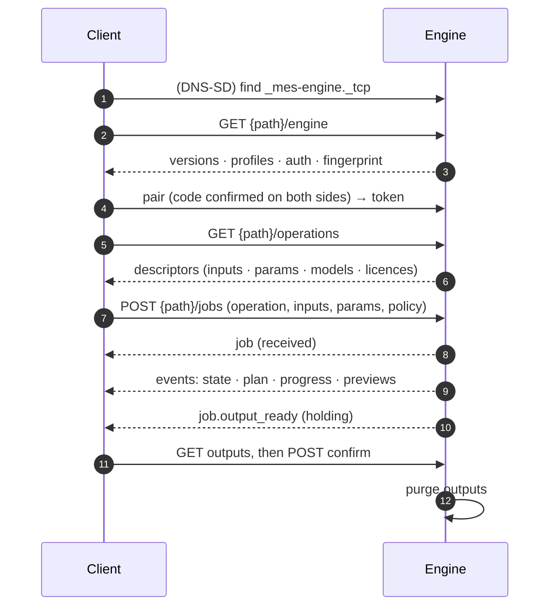
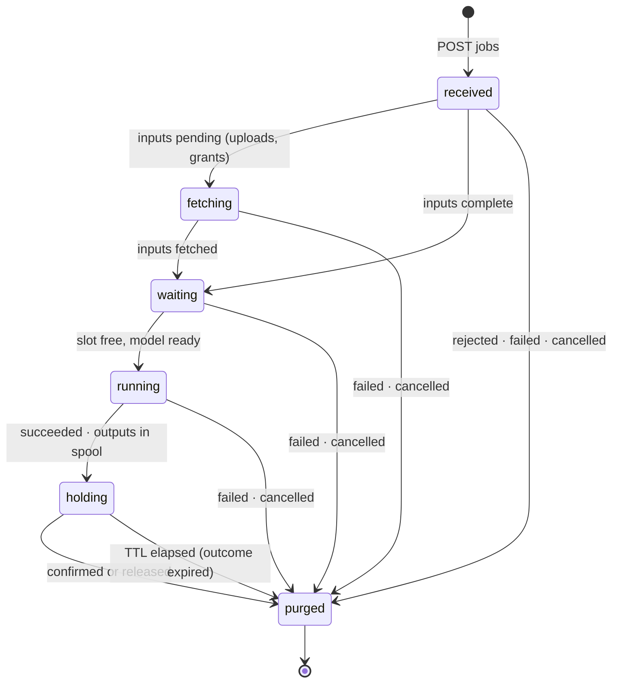

# Media Engine Specification — Base

| | |
|---|---|
| **Version** | 0.1 (draft) |
| **Status** | Draft for review. While the major version is 0, a minor version may make breaking changes. |
| **Date** | 2026-10-30 |
| **Profiles** | [Image 0.1](profiles/image.md), [Audio 0.1](profiles/audio.md). Video is planned. |
| **Schemas** | [`schemas/v0/base/`](../schemas/v0/base/) |

## Abstract

The Media Engine Specification (MES) defines how a **client** talks to a **media engine**: a local or LAN service
that runs AI models on media. This Base document covers what every engine implements, whatever its media type:
- discovery, the handshake and pairing;
- capability descriptors;
- jobs, uploads, events and results;
- retention guarantees;
- provenance and licence reporting;
- errors and bindings.

**Profiles** define the operations and parameter vocabulary for one media type each.

Clients ask for **operations** ("fill this masked region"), never for a model. Engines **normalize** how each model
is used and report what they actually did.

## Conventions

- **Requirement levels:** "MUST", "MUST NOT", "SHOULD", "SHOULD NOT" and "MAY" are used as in RFC 2119 and RFC 8174.
- **Field names:** JSON fields are `snake_case`.
- **Timestamps:** RFC 3339, in UTC.
- **Sizes:** in bytes.
- **Durations:** in seconds with an `_s` suffix, or in milliseconds with an `_ms` suffix.
- **`{path}`:** the engine's base path, by default `/mes/v0` (§3).

## Terminology

| Term | Meaning |
|---|---|
| **Engine** | A service implementing Base and at least one profile. |
| **Client** | Anything that calls an engine: an app, a script, an agent. |
| **Operation** | A profile-defined unit of work, e.g. `image.fill`. Named `<profile>.<verb>`. |
| **Descriptor** | An engine's machine-readable description of one operation it offers (§6). |
| **Job** | One submitted operation, from receipt until its media is purged (§7). |
| **Output** | A media file (or data) a job produced. |
| **Grant** | A short-lived token that lets an engine pull an input from a client's own media server (§9). |
| **Pairing** | The one-time, user-confirmed exchange that makes a client and an engine trust each other (§5). |
| **Spool** | An engine's private storage for a job's inputs and outputs. |

## 1. Overview

## 2. Versioning

1. **Versions.** Base and every profile carry independent versions of the form `MAJOR.MINOR`. While `MAJOR` is 0, a
   `MINOR` change may be breaking.
2. **Advertising.** An engine advertises every Base version and every profile version it supports (§4).
3. **Requests.** A client SHOULD send `MES-Version: <base version>` on each request. An engine that receives an
   unsupported version MUST answer 400 `unsupported_version`, listing the versions it does support.
4. **Responses.** An engine MUST echo the Base version it used in a `MES-Version` response header.
5. **Descriptors.** Each descriptor states the `profile_version` its operation follows (§6).

## 3. Discovery and transport

### 3.1 DNS-SD

An engine that is reachable from other hosts SHOULD advertise the DNS-SD service type **`_mes-engine._tcp`**
(RFC 6762 and RFC 6763). The instance name is the engine's human-readable name. Discovery is platform-neutral:
Bonjour on Apple platforms, Avahi on Linux, and the built-in resolver on Windows all serve it.

| TXT key | Requirement | Meaning |
|---|---|---|
| `txtvers` | MUST | `1` |
| `mes` | MUST | Comma-separated Base versions, e.g. `0.1` |
| `profiles` | MUST | Comma-separated `profile/version`, e.g. `image/0.1,video/0.1` |
| `id` | MUST | The engine's stable identifier (a UUID) |
| `auth` | MUST | `paired` or `open` (§3.3) |
| `tls` | MUST | `1` if the engine serves TLS, `0` otherwise |
| `path` | SHOULD | The base path; default `/mes/v0` |
| `ver` | SHOULD | The implementation's version |
| `load` | MAY | The current load, 0–100 |

TXT values are hints. A client MUST confirm them with `GET {path}/engine` before relying on them. Engines MAY also
be reached by address, without DNS-SD.

An engine reachable only from its own machine (`open` mode, or bound to loopback) MAY advertise on that machine only,
so local clients can find it without it being announced on the LAN. It SHOULD register on the loopback interface
rather than the DNS-SD local-only pseudo-interface, which some browsing APIs (Network.framework's `NWBrowser`) don't
report.

### 3.2 HTTP

- **Protocol:** engines MUST support HTTP/1.1 and MAY support HTTP/2.
- **Bodies:** request and response bodies are JSON (`application/json`, UTF-8) unless stated otherwise.
- **Request IDs:** every response SHOULD carry `MES-Request-Id`.
- **Browsers:** an engine MUST refuse any request whose `Origin` header names an origin outside its allowlist, with
  403 `origin_not_allowed`, before acting on it. The default allowlist is empty. This guards against cross-site
  requests from web pages.

### 3.3 Security modes

| Mode | Transport | Who may connect | Authorization |
|---|---|---|---|
| `paired` | TLS, with a self-signed certificate the client pins at pairing | Any host | `Authorization: Bearer <token>` from pairing (§5) |
| `open` | HTTP or TLS | **Loopback only.** An engine MUST NOT accept `open`-mode requests from other addresses. | None |

`GET {path}/engine` and the pairing endpoints need no token. Every other endpoint MUST answer 401 `unauthorized`
without a valid token in `paired` mode.

## 4. Engine information

`GET {path}/engine` returns the handshake document ([`engine-info.schema.json`](../schemas/v0/base/engine-info.schema.json)):

- `id`, `name`
- `implementation`: `{name, version, url?}`
- `base_versions` and `profiles`: `[{id, versions}]`
- `auth`, `tls.fingerprint_sha256`
- `features`: a subset of `uploads`, `grants`, `sse`, `websocket`, `mcp`, `previews`, `pairing`, `assets` (§8.1),
  `streaming` (§11)
- `limits`: `max_upload_bytes`, `max_inline_bytes`, `max_queued_jobs_per_client`; with `assets`, `max_asset_ttl_s`
  (REQUIRED, at most 604 800) and `max_asset_bytes_per_client`
- `retention`: `outputs_ttl_s`, `job_record_ttl_s`

`uploads` and `sse` are REQUIRED features. An engine in `paired` mode MUST support `pairing`. An engine claims
`streaming` exactly when some model offer has `supports.stream` (§6.4).

## 5. Pairing

Pairing establishes trust between a client and an engine on a LAN, without accounts. It binds the engine's TLS
certificate and the client's key to a **6-digit code** that a person compares on both screens.

1. **TLS.** The client opens TLS to the engine and provisionally accepts its self-signed certificate. `FE` is the
   SHA-256 fingerprint of the engine certificate (DER).
2. **Client key.** The client holds a P-256 key pair for its identity. `FC` is the SHA-256 of its public key (SPKI,
   DER).
3. **Request.** `POST {path}/pairings` with `{client_id, client_name, client_key, client_nonce}`. `client_key` is the
   SPKI as base64url; `client_nonce` is 32 random bytes as base64url. The engine answers 201 with
   `{pairing_id, engine_nonce, expires_at}`.
4. **The code.** Both sides compute
   `code = (uint32_be(HMAC-SHA256(key: client_nonce ‖ engine_nonce, msg: "MES-SAS-1" ‖ FE ‖ FC)[0..4]) mod 1000000)`,
   zero-padded to 6 digits.
   - The engine MUST show the code and `client_name` to a local user, and MUST require that user's approval, unless
     an operator policy pre-approves pairing.
   - The client shows the code to its user.
5. **Confirm.** The client calls `POST {path}/pairings/{pairing_id}/confirm`:
   - **202** `{state: "awaiting_approval"}` while the engine waits; the client MAY send `Prefer: wait=<s>`.
   - **200** `{token, client_id}` once approved. The token is returned once; a later confirm answers 404.
   - **403** `pairing_rejected` if declined.
   - **410** `gone` if expired.
6. **Afterwards.** The client pins `FE` and keeps the token. The engine stores only a hash of the token, bound to
   `FC`.
7. **Unpairing.** `DELETE {path}/pairings/self` removes the caller's pairing and answers 204. An engine MAY revoke a
   pairing at any time, after which the token yields 401.

A man in the middle substitutes either `FE` or `FC`, which changes the code. Pairing pages expire within 5 minutes.

## 6. Capability descriptors

- `GET {path}/operations` returns `{operations: [Descriptor], etag}`.
- `GET {path}/operations/{operation}` returns one descriptor.
- Both support `ETag` and `If-None-Match`.

Schema: [`descriptor.schema.json`](../schemas/v0/base/descriptor.schema.json).

A descriptor states:

| Field | Meaning |
|---|---|
| `operation`, `profile`, `profile_version` | What this is, e.g. `image.fill`, `image`, `0.1` |
| `title`, `summary` | Human text for UIs |
| `inputs` | Each named input: `kind` (`text`, `image`, `mask`, `video`, `audio`, `data`), `required`, `min`/`max` count, accepted `media_types` |
| `params` | A JSON Schema (draft 2020-12) object for the parameters, with `x-mes-ui` hints on each property (§6.1) |
| `outputs` | Each named output: `kind`, `media_types`, count range, and `stream?: {encodings}` for an output that can stream (§11) |
| `limits` | E.g. `max_width`, `max_height`, `max_megapixels`, `max_duration_s`, and the limit fields the profile defines (`max_…`, `min_…`). The operation's limits are the most any offer allows (§6.4) |
| `quality_tiers` | The tiers this operation offers: a non-empty subset of `draft`, `standard`, `best` |
| `models` | The model offers: `id`, `title`, `license` (§10.2), `memory_class`, `speed_class`, `quality_tiers`, `default`, `named_only?`, `remote_provider?`, `notes?`, `adapters?`, `max_adapters?` (§6.3), `supports?`, `limits?` (§6.4) |
| `extensions` | Optional, namespaced extra parameters (§6.2) |
| `remote` | Whether this operation may run at a remote provider, and which providers |
| `retention` | `outputs_ttl_s` for this operation, if different from the engine's |

Rules:
1. **Vocabulary.** `params` MUST use the profile's vocabulary names for the concepts the profile defines (e.g.
   `seed`, `quality`), and MUST NOT require model-specific parameters.
2. **Model choice.** Model choice is optional for clients. An engine MUST pick a default when the request names no
   model. An offer marked `named_only` (typically research-licensed or otherwise opt-in) MUST NOT be chosen that way:
   it runs only when a request names it. An offer can't be both `default` and `named_only`. The choice MAY depend on
   the request's params (an Image restore picking its network by `kind`). It stays within the requested quality tier
   and the request's policy, and the `default` offer is the choice when the params don't decide it. A request that asks
   for no tier may run at another tier when no offer at the default tier admits it (§6.4).
3. **Stability.** A descriptor MUST be stable for an engine version, except that `models` and `remote` may change at
   runtime. Such changes are announced with `engine.operations_changed` (§11).
4. **No surprises.** Limits a model cannot honour (sizes, durations, unsupported vocabulary such as
   `negative_prompt`) MUST be stated in the descriptor, not discovered by failure: for the operation in `limits` and
   `params`, and for one model in its offer's `supports` and `limits` (§6.4).
5. **Notes.** An offer MAY carry `notes`: short, plain-text usage guidance for that model, such as how to write its
   prompt or a limit worth knowing before naming it (at most 1000 characters; a sentence or two is better). Notes
   advise; they never change the request's meaning, and anything a client must enforce still belongs in `params`,
   `limits` or `license`. Clients MAY show notes and MAY ignore them. Licence terms go in `license.notice`, not here.
6. **Operations.** An engine offers only operations that a profile it implements defines; the operation id's prefix
   names the profile. Behaviour no profile defines goes in extensions (§6.2), or is proposed as a profile change.

### 6.1 UI hints

`x-mes-ui` on a parameter property MAY contain:
- `label`, `help`, `group`, `order`;
- `advanced` (boolean);
- `widget`: one of `text`, `textarea`, `slider`, `stepper`, `picker`, `toggle`, `seed`, `size`, `aspect`, `color`,
  `voice` (a picker filled from the chosen model's voice list, §6.5, that can play each `sample`).

Clients MAY ignore hints, but SHOULD use them when they render forms from descriptors.

### 6.2 Extensions

An extension is a named, optional parameter group, `{name, title, schema}`.
- **Names:** `x-<vendor>.<name>`, for example `x-ltx.lora`.
- **Requests:** clients send extension values under `extensions.<name>`.
- **Unknown extensions:** an engine MUST reject an unknown extension with 422 `unsupported_parameter`.
- **Optional by design:** a request without extensions MUST still succeed.

### 6.3 Adapters

An **adapter** is a small set of weights that changes what a model produces (a style, a character, a pose), such as a
LoRA. Clients choose adapters the way they choose models: from the descriptor, by id. Engines offer only adapters
their operator installed; a request can't carry weights.

A model offer lists the adapters it accepts in `adapters`, and in `max_adapters` how many one request may combine
(default 1). Each adapter offer has:

| Field | Meaning |
|---|---|
| `id`, `title` | The adapter. An id names the same adapter in every offer and operation that lists it. |
| `kind` | `plain` (weights only) or `ic` (in-context: the adapter also takes reference media, its `slots`) |
| `slots` | For `ic` adapters, the ordered media it takes, one value each: `{role, kind, required?, notes?}` (`required` defaults to `true`). The profile says which input fills them. |
| `strength` | `{min, max, default}`: the range a request may ask for, and what it gets when it names none |
| `license` | The adapter's own licence (§10.2), which applies on top of its model's |
| `notes` | OPTIONAL. Usage guidance, such as a trigger word, as for model offers (§6 rule 5) |

Rules:
1. **Requests.** A request lists adapters in `adapters` (§7.1), each `{id, strength?}`. An id listed twice is 400
   `invalid_request`.
2. **An adapter implies its model.** With no model named, the engine chooses among the offers that list every
   requested adapter, by §6 rule 2 (a `named_only` offer still runs only when named). These are refused with 422
   `unsupported_parameter`: an adapter no offer of the operation lists, one the named model doesn't list, and a set
   that no offer the engine may choose takes.
3. **Limits.** More adapters than the model's `max_adapters`, or a strength outside an adapter's range, is 422
   `out_of_limits`.
4. **Licences.** The licence policy covers adapters (§10.3), and provenance lists them (§10.1).
5. **Discovery first.** Clients send `adapters` only to offers that list them. An engine older than this section may
   ignore the field.

### 6.4 What an offer supports

One descriptor gathers models that accept different things: languages, voices, cloning, emotions, streaming, a seed.
A model offer states its own with two optional fields ([RFC 0003](../rfcs/0003-offer-supports-and-voices.md)):
- `supports`: facts about what the model accepts, beyond what every offer of the operation accepts;
- `limits`: its own limits, the descriptor's `limits` fields and the profile's, each within the operation's (a `max_`
  no higher, a `min_` no lower).

Each `supports` key is defined by Base or the operation's profile, with its type, what its absence means, and its class:

| Class | Meaning |
|---|---|
| **Gate** | Some request content uses the key: a parameter, an input, or a value of one. That request needs an offer that supports it. |
| **Warn** | An offer without the key still runs the request, and warns with the code the definition names. |
| **Fact** | No request uses the key. It informs clients, e.g. an output's sample rate. |

Rules:
1. **Absence.** A key's definition says what omitting it means. A key added to an existing profile version defaults
   to that version's current behaviour, so older offers keep their meaning.
2. **A request implies its offers.** With no model named, the engine chooses among the offers whose gate keys and
   `limits` admit the request, then applies §6 rule 2 (tier, policy, `named_only`, `default`) and §6.3 rule 2. When
   the request asks for no tier and no offer at the default tier admits it, the engine MAY use another tier whose
   offers do. If none admits the request: 422 `unsupported_parameter` for a gate, `out_of_limits` for a limit, with
   `param` naming what no offer admits.
3. **A named model** that doesn't support what the request uses gets the same answers. The engine MUST NOT ignore it
   or substitute a model.
4. **Warn keys** never narrow the choice.
5. **Names.** Only keys Base or the profile defines, or `x-<vendor>.<name>` keys. Clients MUST ignore keys they don't
   know.
6. **Discovery first.** Clients read `supports` and `limits` before naming a model. An engine older than this section
   declares neither, and its offers behave as each key's absence says.

**Base keys:**

| Key | Type | Absent | Class | Meaning |
|---|---|---|---|---|
| `stream` | boolean | `false` | Gate: a request's `stream` (§7.1) | The model can stream its output. The profile's Facts give the stream's format before the run (Audio: `sample_rate`, `channels`) |
| `seed` | boolean | `true` | Warn: `seed_ignored` | `false`: the result doesn't depend on a seed, e.g. greedy decoding |
| `voices` | integer | `0` | Fact (§6.5) | How many preset voices the model offers |

### 6.5 Voices

A **voice** is a speaker identity a model offers by name: a preset the model ships or the operator installed. A
client's own voice is a reference input, and an asset when reused (§8.1), not a voice.

`GET {path}/operations/{operation}/models/{model}/voices` returns `{voices: [Voice], etag}`
([`voices.schema.json`](../schemas/v0/base/voices.schema.json)) for a model whose `supports.voices` is above 0, with
`ETag` and `If-None-Match` as for `GET {path}/operations`. A model the operation doesn't offer, or one with no voices,
is 404 `not_found`.

| Field | Meaning |
|---|---|
| `id`, `title` | The voice. An id names the same voice in every model that lists it. |
| `languages` | OPTIONAL. The BCP 47 tags it speaks well; absent, the model's own |
| `tags` | OPTIONAL. Descriptive words for pickers and agents (`female`, `british`, `calm`). A profile MAY suggest a vocabulary |
| `notes` | OPTIONAL. Usage guidance, as for offers (§6 rule 5) |
| `sample` | OPTIONAL. An `href` on the engine to a short sample, fetched with the usual authorization |
| `license` | OPTIONAL. The voice's own terms (§10.2), on top of its model's, such as a voice actor's consent terms |

The catalogue is the client's: the engine serves the list, and searching, filtering, favourites and caching belong to
the client. An operator adding or removing voices changes `supports.voices`, announced with
`engine.operations_changed`.

Rules:
1. **Requests.** A profile parameter names the voice by id (Audio: `voice`).
2. **A voice implies its model,** as an adapter does (§6.3 rule 2). These are 422 `unsupported_parameter`, with
   `param` naming the profile's parameter: a voice no offer lists, one the named model doesn't list, and one listed
   only by offers the engine may not choose.
3. **Licences.** The licence policy covers voices (§10.3), and provenance names the voice that spoke (§10.1).

## 7. Jobs

### 7.1 Submitting

`POST {path}/jobs` with a JobRequest ([`job-request.schema.json`](../schemas/v0/base/job-request.schema.json)):

| Field | Meaning |
|---|---|
| `operation` | REQUIRED. An operation id from a descriptor. |
| `inputs` | Named inputs. • **Text:** a string. • **Media:** one InputValue or an array of them: `{"inline"}`, `{"upload"}`, `{"grant"}` or `{"asset"}` (§8, §8.1, §9). • **Data:** `{"data": <JSON>}`, e.g. segmentation points. |
| `params` | Parameters valid against the descriptor's `params` schema. |
| `model` | OPTIONAL. A model id from the descriptor. |
| `policy` | `license`: `any` (default) or `commercial-use`. `remote`: `forbid` (default) or `allow` (§10.3). |
| `extensions` | OPTIONAL. Values for declared extensions. |
| `adapters` | OPTIONAL. Adapters to apply, in order: `[{id, strength?}]` (§6.3). |
| `stream` | OPTIONAL. Outputs to stream as chunks while the job runs: `[{output, encoding?}]` (§11). `encoding` defaults to the first the output spec lists. |
| `client_ref` | OPTIONAL. An opaque string (≤ 128 characters) echoed in the job and its events. |

**Responses:**
- **201,** with the Job snapshot and `Location: {path}/jobs/{id}`.
- **400** `invalid_request` for a malformed request, including one that breaks its descriptor's structure: a
  required input missing, fewer values than an input's `min`, or parameters the profile makes mutually exclusive.
- **422** for a well-formed request the engine can't accept. Codes: `out_of_limits`, `unsupported_parameter`,
  `policy_unmet`, `input_invalid` (§12).
- **429** `busy`, with `Retry-After`, when the client's queue limit is reached.

**Streaming** implies its model (§6.4): `stream` on an output whose spec has no `stream`, a registered encoding the
spec doesn't list, a named model without `supports.stream`, or a request no offer the engine may choose can stream,
is 422 `unsupported_parameter` with `param: "stream"`.

**Idempotency.** An engine SHOULD honour `Idempotency-Key` for 24 hours per paired client, returning the original
job.

### 7.2 Lifecycle

The Job snapshot is defined in [`job.schema.json`](../schemas/v0/base/job.schema.json):

| Field | Meaning |
|---|---|
| `id`, `operation`, `client_ref?` | Identity |
| `state` | One of `received`, `fetching`, `waiting`, `running`, `holding`, `purged` |
| `outcome` | Set once known: `succeeded`, `failed`, `cancelled` or `expired` |
| `plan` | Once decided: `model` (an id plus `license`), `effective` parameters, `remote_provider?`, and `streams?: [{output, encoding, sample_rate, channels}]` for the outputs being streamed |
| `progress` | `stage` (`fetching`, `waiting`, `preparing`, `running`, `finishing`), `phase?`, `step?`, `steps?`, `fraction?`, `media_s?`, `message?`. `phase` is a short id for the part of the run in progress (`plan`, `generate`, `denoise`, `decode`), with `step` and `steps` counting within it; `media_s` is the seconds of media made so far, for a job whose length isn't known in advance |
| `warnings` | Every deviation from the request (§10.1) |
| `result` | Present in `holding`: the outputs and provenance (§10) |
| `error` | Present when `outcome` is `failed` (§12) |
| `retention` | `outputs_expire_at?`, `record_expires_at` |
| `created_at`, `updated_at` | Timestamps |

### 7.3 Reading, waiting, cancelling, collecting

| Request | Effect |
|---|---|
| `GET {path}/jobs/{id}` | The snapshot. `?wait=<s>` (≤ 60) long-polls while the job is active (`received`, `fetching`, `waiting`, `running`): it answers when the state changes. A job already `holding` or `purged` answers at once. |
| `GET {path}/jobs?state=…` | The caller's own jobs. A client never sees another client's jobs. |
| `GET {path}/jobs/{id}/outputs/{index}` | The output's bytes, with its `Content-Type` and `ETag: "sha256:<hex>"`. Byte ranges MUST be supported. After purge: 410 `gone`. |
| `POST {path}/jobs/{id}/confirm` | The client has what it needs. The engine purges the outputs; the state becomes `purged` and the outcome stays `succeeded`. |
| `DELETE {path}/jobs/{id}` | **Release.** Before `holding`, it cancels (outcome `cancelled`). In `holding`, it discards the outputs. Release is idempotent. A release while a job streams stops it: the engine sends no more chunks, and SHOULD act within one chunk's duration. |

## 8. Uploads

`POST {path}/uploads` sends one file's bytes as the raw body, with its `Content-Type`. The client SHOULD include
`Content-Digest: sha-256=:<base64>:`, which the engine then MUST verify.

The engine answers 201 with `{upload_id, media_type, bytes, sha256, expires_at}`.

- **Use:** in `inputs`, an upload is `{"upload": "<upload_id>"}`.
- **Single use:** an upload is consumed by the first job that names it, and deleted when that job leaves `running`,
  in any outcome. An unused upload is deleted at `expires_at`, which MUST be no more than 1 hour away.
- **Limits:** bigger than `limits.max_upload_bytes` → 413 `too_large`.

**Inline inputs.** `{"inline": {"media_type": "...", "data": "<base64>"}}` is allowed up to
`limits.max_inline_bytes` (SHOULD be at least 8 MiB).

### 8.1 Assets (`assets` feature)

An **asset** is a file a client keeps on the engine for any number of its jobs, until it deletes it or it expires
([RFC 0001](../rfcs/0001-assets.md)). The client chooses what is kept and for how long, so the engine may keep what it
derives from an asset, such as an encoded voice, for as long as the asset lives (§13 rule 6).

- **Creating.** `POST {path}/assets?ttl_s=<s>` sends one file's bytes as the raw body, with its `Content-Type`, as an
  upload does, and the same `Content-Digest` rule. `ttl_s` is REQUIRED and at least 60; without it, 400
  `invalid_request`. The engine grants at most `limits.max_asset_ttl_s`, and answers 201 with an Asset
  ([`asset.schema.json`](../schemas/v0/base/asset.schema.json)): `{asset_id, media_type, bytes, sha256, created_at,
  expires_at}`. Bigger than `max_upload_bytes`, or over `max_asset_bytes_per_client`, is 413 `too_large` (a `reason`
  names the quota).
- **Using.** In `inputs`, an asset is `{"asset": "<asset_id>"}`, wherever an upload may stand. An asset that is
  unknown, expired, deleted or another client's is 422 `input_invalid` with `param` naming the input. A job already
  accepted keeps its input if the asset is deleted later.
- **Listing.** `GET {path}/assets` returns `{assets: [Asset]}`, the caller's own; `GET {path}/assets/{id}` one. An
  engine never serves an asset's bytes back.
- **Deleting.** `DELETE {path}/assets/{id}` answers 204, or 404 `not_found` for an asset the caller doesn't have.
- **Ownership.** An asset belongs to the client that created it, as a job does. `open` mode's local callers share
  assets as they share jobs. Removing a pairing deletes that client's assets.
- **Restarts.** An engine MAY drop its assets when it restarts. A client that gets 422 `input_invalid` for an asset it
  holds treats it as gone, and creates it again.

## 9. Grants: pulling inputs from the client

A client that keeps custody of its media MAY serve it to the engine instead of uploading it. An InputValue of
`{"grant": {"url", "token", "media_type", "bytes?", "sha256?"}}` asks the engine to fetch the bytes itself.

1. **Fetching.** The engine fetches `url` with `Authorization: Bearer <token>`. It MUST verify `sha256` when one is
   given, and MUST NOT follow redirects.
2. **Where from.** The engine MUST fetch grant URLs only from the host that submitted the job (or loopback, for a
   local client). This prevents an engine being used to reach other hosts.
3. **Retention.** Fetched bytes follow the same retention as uploads (§13).
4. **Token lifetime.** The client SHOULD invalidate the token once the job leaves `running`.

Engines without the `grants` feature answer 422 `unsupported_parameter`; clients then fall back to uploads.

## 10. Results, provenance and policy

### 10.1 Results

In `holding`, `result` holds:

| Field | Meaning |
|---|---|
| `outputs` | Each output: `index`, `name` (from the descriptor), `kind`, `media_type`, `bytes`, `sha256`, `href`, plus media facts: `width`, `height`, `duration_s`, `fps`, `sample_rate`, `channels`, `bit_depth` as relevant. A `data` output MAY carry its JSON as `value` (≤ 64 KiB). |
| `effective` | The normalized parameters actually used, e.g. the chosen `quality`, a snapped `size`, the `seed`. Model-specific detail MAY appear under `effective.model_params`. |
| `provenance` | `engine {id, name, implementation, version}`, `operation`, `profile_version`, `model {id, title, revision?, license}`, `adapters? [{id, title?, revision?, license, strength}]`, `helpers? [{id, title?, revision?, license, role}]`, `voice? {id, title?, license?}` (§6.5), `remote_provider? {id, name, billed}`, `seed?`, `timings {received_at, started_at?, finished_at?, queue_ms?, prepare_ms?, run_ms?}` |

**Adapters and helpers.** `provenance.adapters` lists the adapters the job applied (§6.3), with the strength each
ran at. `provenance.helpers` lists any other model that shaped the result without producing it, such as a text model
that rewrote the prompt, with its `role`. Profiles register helper roles. Both are present only when not empty.

**Streamed outputs.** A streamed output is the concatenation of its chunks' samples, in `index` order, encoded as the
output's media type. When that is PCM in the stream's sample format (`audio/wav` with 16-bit integer samples for
`pcm_s16le`, 32-bit float for `pcm_f32le`), the samples MUST be identical. An engine MUST NOT change audio it has
streamed: no normalizing, trimming or re-synthesis afterwards. A streamed job need not match a non-streamed job with
the same parameters and seed; an offer whose streamed results differ SHOULD say so in its `notes`.

**Warnings.** Every change from the request is a warning, `{code, message, param?}`, in the job's `warnings`. A
seed that was ignored, a size snapped to a grid, or a mask resampled MUST each produce one. Profiles register their
warning codes. An engine MAY use a code no registry defines, for a deviation the registries don't cover; clients
MUST accept codes they don't know, and show the `message`.

### 10.2 Licence

The `license` object on a model offer and on provenance:

| Field | Meaning |
|---|---|
| `spdx` | An SPDX identifier, or a `LicenseRef-…` for custom terms (e.g. `Apache-2.0`, `LicenseRef-Qwen-Research`) |
| `commercial_use` | `true`, `false` or `unknown`: whether the weights' terms permit commercial use of outputs |
| `terms_url` | Where the full terms are |
| `notice` | OPTIONAL. Short text the client should show, e.g. an attribution requirement |
| `accepted_required` | OPTIONAL. `true` when the engine requires its operator to accept the terms before first use |

### 10.3 Policy

- **`license: commercial-use`.** The engine MUST use only models whose `license.commercial_use` is `true`, and the
  same holds for the job's adapters and helpers (§10.1).
  - If no model can serve the request, or the named model or a requested adapter doesn't satisfy the policy, the
    engine MUST refuse with 422 `policy_unmet`.
  - A helper that doesn't satisfy it is left out, with the warning `helper_skipped_by_policy`, or the request is
    refused with 422 `policy_unmet`.
- **Voices.** `license: commercial-use` also requires a voice's own `license`, when it has one, to permit commercial
  use; if it doesn't, 422 `policy_unmet`.
- **`remote: forbid`** (the default). The engine MUST NOT send the request or its inputs to a remote provider.
- **`remote: allow`.** The engine MAY use a remote provider. The plan and the provenance MUST then name it, and
  `billed` says whether the provider charges.

## 11. Events

Event schema: [`event.schema.json`](../schemas/v0/base/event.schema.json). Every event has:
- `type`;
- `job` (absent for engine events);
- `seq`, monotonic per job;
- `time`;
- `data`.

| Type | Data |
|---|---|
| `job.state` | `{state, outcome?}` |
| `job.plan` | `{model, effective, remote_provider?}`, once decided |
| `job.progress` | `{stage, step?, steps?, fraction?, message?}`. Engines SHOULD send at most 10 per second. |
| `job.preview` | `{media_type, href}`, or inline `data` (≤ 256 KiB base64) |
| `job.warning` | A Warning |
| `job.output_chunk` | `{output, index, offset_s, final, data?}`: a piece of a streamed output (below) |
| `job.output_ready` | `{outputs}`; the job is now `holding` |
| `job.ended` | `{outcome, error?}`, when the job reaches `purged`. For a succeeded job that is after confirm, release or expiry, so a client that only needs the outputs can stop reading at `job.output_ready`. |
| `engine.health` | Health (§14); WebSocket only |
| `engine.operations_changed` | `{etag}`; WebSocket only |

**Streamed output (`streaming` feature).** A request may ask for an output to arrive as ordered chunks while the job
runs ([RFC 0002](../rfcs/0002-streamed-output.md)). In Base 0.1 only `audio` outputs whose `max` is 1 stream. Stream
encodings are raw interleaved little-endian PCM without a header: `pcm_s16le` (16-bit integer) and `pcm_f32le` (32-bit
float). The plan's `streams` gives each stream's `sample_rate` and `channels` before the first chunk.
- **`output`** names the output; **`index`** counts 0, 1, 2, … per output, with no gaps; **`offset_s`** is where the
  chunk starts (informative: the exact position is the frame count of the chunks before it).
- **`data`** is the chunk's samples, base64, whole frames only, at most 256 KiB of base64.
- **`final`** is `true` on the last chunk of the output, which MAY be empty.

Rules:
1. **When.** Chunks are sent while the job is `running`. An output's final chunk is sent only once the job has
   succeeded, right before `job.output_ready`.
2. **Pace.** An engine sends chunks as it makes them, not at playback speed, and SHOULD send at most 50 a second per
   output.
3. **Channels.** Chunks go wherever the job's other events go: SSE, WebSocket, and in-process.
4. **Replay.** Chunks are replayed like other events while the job's outputs exist. After they are purged, a replayed
   chunk carries no `data`.
5. **Failure.** A job that fails or is cancelled after streaming sends no final chunk. What it streamed isn't an
   output, and a client SHOULD treat it as incomplete.

The MCP binding doesn't stream: a tool call returns once, with the finished output (§15).

**SSE (REQUIRED).** `GET {path}/jobs/{id}/events` returns `text/event-stream`.
- Each event is framed as `id: <seq>`, `event: <type>`, `data: <JSON>`.
- Clients resume with `Last-Event-ID`.
- The engine sends a comment heartbeat at least every 15 s.
- The stream ends after `job.ended`.

**WebSocket (`websocket` feature).** `GET {path}/ws` upgrades. The client authenticates with the `Authorization`
header.
- **Client messages:** `{"type":"subscribe","jobs":["<id>"]|"*"}`, `{"type":"unsubscribe","jobs":[…]}`,
  `{"type":"cancel","job":"<id>"}` and `{"type":"ping"}`.
- **Engine messages:** events, `{"type":"pong"}`, and `{"type":"error","error":{…}}` (a §12 error object) for a
  message the engine can't act on, such as a malformed message, an unknown job, or a cancel that is refused. The
  connection stays open after an error.
- **Scope:** a subscription to `"*"` covers the client's own jobs and engine events.
- **Subscribing to a job** replays its events from the first, as SSE does without `Last-Event-ID`. Events can arrive
  twice when subscriptions overlap (`"*"` and the job's id); `(job, seq)` identifies an event.
- **Engine events** (no `job`) carry a `seq` that is monotonic per connection. `engine.health` is sent when `"*"` is
  subscribed, and then periodically.
- **Refused upgrades:** origin and authorization rules apply to the upgrade request. An engine that refuses answers
  with a 4xx status, with the §12 body when its stack allows; clients learn the reason with an ordinary request.

## 12. Errors

Every error body is `{"error": {code, message, reason?, param?, job?, request_id?}}`
([`error.schema.json`](../schemas/v0/base/error.schema.json)).

| HTTP | `code` |
|---|---|
| 400 | `invalid_request`, `unsupported_version` |
| 401 | `unauthorized` |
| 403 | `forbidden`, `origin_not_allowed`, `pairing_rejected` |
| 404 | `not_found`, `unknown_operation` |
| 409 | `conflict`, `already_confirmed` |
| 410 | `gone` |
| 413 | `too_large` |
| 415 | `unsupported_media_type` |
| 422 | `out_of_limits`, `unsupported_parameter`, `policy_unmet`, `input_invalid`, `model_unavailable` |
| 429 | `busy` (with `Retry-After`) |
| 500 | `engine_error` |
| 502 | `input_fetch_failed`, `remote_provider_failed` |
| 503 | `no_capacity` (with `Retry-After`) |

A failed job carries the same object in `error`. Clients MUST treat unknown codes by their HTTP class.

## 13. Retention guarantees

These are normative, because clients trust engines with their media on the strength of them.

1. **Inputs.** Inline data, uploads and grant-fetched bytes MUST be deleted within 60 s of the job leaving
   `running`, whatever the outcome. An upload that is never used MUST be deleted at its `expires_at`.
2. **Outputs.** Outputs MUST be held only in `holding`, and deleted on confirm, on release, or when `outputs_ttl_s`
   elapses. `outputs_ttl_s` MUST NOT exceed 86 400 and SHOULD default to 3 600. A streamed output's chunks are part of
   it: their data is kept only as long as the output, and a job that fails or is cancelled deletes it within 60 s.
3. **Crashes.** After a crash or restart, an engine MUST delete the spooled media of interrupted jobs before
   accepting new jobs.
4. **No other copies.** An engine MUST NOT keep inputs, outputs or anything derived from them beyond rules 1–3 and 6. Job
   records (metadata, without media) MAY be kept until `record_expires_at`, at most `retention.job_record_ttl_s`.
5. **No logging of media.** An engine MUST NOT log media, and SHOULD NOT log prompts beyond the job record.
6. **Assets.** An engine MAY keep an asset's bytes, and anything it derives from those bytes alone for reuse (an
   encoded speaker reference, image features), until the asset is deleted or expires (§8.1). It MUST delete them
   within 60 s of that, and within 60 s of the client's pairing being removed. What it derives from an asset serves
   only jobs that name that asset: a cache keyed by bytes, which another client's identical upload could hit, is not
   allowed. Anything derived from a job's other inputs, or from an asset together with them, follows rules 1–4.

The conformance suite tests what is observable. For example, an output fetched after confirm MUST answer 410.

## 14. Health

`GET {path}/health` returns ([`health.schema.json`](../schemas/v0/base/health.schema.json)):
- `status`: `ok`, `degraded` or `unavailable`;
- `queue_depth`, `running?`, `resident_models`;
- `memory`: `{headroom_bytes?, class?}`;
- `estimated_wait_s?`.

Dispatchers use it to choose between engines.

## 15. MCP binding (`mcp` feature)

- **Endpoint:** `{path}/mcp`, MCP Streamable HTTP (protocol 2025-06-18 or later), using the same authorization.
- **One tool per operation.** It is named like the operation, with `.` replaced by `_` (`image_fill`). Its input
  schema is the descriptor's `params`, plus:
  - the inputs, each a string: a data URL, `upload:<id>`, or `asset:<id>` (an asset the client created over HTTP; the
    binding creates none);
  - `model`, `quality`, `wait_s` (default 50) and `policy`;
  - `adapters` (§6.3), when an offer lists any.
- **Model lines.** The tool's description lists each model offer on one line: its id, title, licence and
  commercial-use flag. An offer's `license.notice` and `notes` (§6 rule 5), when present, follow on that model's line,
  so an agent sees the terms and the usage guidance before it names the model. The offer's adapters follow on lines of
  their own, each with its id, title, kind, licence and commercial-use flag. An offer's `supports` and `limits` follow
  in short form (`supports: stream, languages=en/zh, max_text_chars=2000`), and a model with voices says how many
  (`10 voices (mes_list_voices)`).
- **Results** contain:
  - a text summary: model, licence, adapters, helpers, warnings;
  - an image preview, for image outputs of at most 1 MB; an `audio` block, for audio outputs of at most 1 MB;
  - a `resource_link` to each output's `href`;
  - `structuredContent`: the Job snapshot.
- **Progress:** `notifications/progress` while waiting, from 0 to 100. Engines MAY send them on the session's
  standalone GET stream rather than on the call's own response stream, so clients that want progress SHOULD open it.
  An engine that does SHOULD hold a session's progress until the client first opens that stream, so progress sent
  before it connects isn't lost.
- **Long jobs:** a job not finished by `wait_s` returns the snapshot with its state, and the agent continues with
  `mes_get_job`.
- **Helper tools:** `mes_list_operations`, `mes_get_job`, `mes_cancel_job`, `mes_confirm_job`, and
  `mes_list_voices {operation, model}`, which returns a model's voice list (§6.5): a line per voice, and the list as
  `structuredContent`.
- **Expiry:** MCP results are not confirmed automatically; outputs expire by TTL.

## 16. Conformance

An engine **conforms to Base 0.1** when it passes the Base tests of the conformance suite for every feature it
claims. Required features: engine information, descriptors, jobs, uploads, SSE events, errors, retention and health.
Pairing is required in `paired` mode.

A client conforms when it passes the client tests against the mock engine, which plays scenarios (busy, no
capacity, failed and cancelled jobs, unknown error codes, expired outputs). These check that it:
- sends only described parameters;
- handles every state, outcome and error class;
- honours `Retry-After`;
- confirms or releases what it collects.

Test IDs are `BASE-nnn` (Base) and `<PROFILE>-nnn` (profiles). The catalogue is [`docs/CONFORMANCE.md`](../docs/CONFORMANCE.md).

## 17. Security and privacy considerations

- **Pairing** (§5) resists a man in the middle on the LAN. Tokens are bearer tokens, valid only over the pinned TLS
  channel; engines store only their hashes.
- **`open` mode** is loopback-only by rule (§3.3).
- **Browsers** are refused unless allowlisted (§3.2).
- **Grants** cannot be turned into a way to reach other hosts (§9 rule 2).
- **Decompression bombs:** engines MUST enforce their `limits` on decoded media (pixels, frames, audio samples and
  seconds), not only on bytes: a small FLAC can decode to hours.
- **Assets** are the only client media an engine keeps past a job, for at most `max_asset_ttl_s` (§8.1, §13 rule 6).
  An engine SHOULD keep them where only it can read them, and SHOULD exclude them from backups.
- **No undeclared traffic:** engines SHOULD send nothing anywhere except to remote providers allowed by policy, and
  model downloads their operator approved.

## 18. Registries

| Registry | Values in 0.1 |
|---|---|
| Features | `uploads`, `grants`, `sse`, `websocket`, `mcp`, `previews`, `pairing`, `assets`, `streaming` |
| Input / output kinds | `text`, `image`, `mask`, `video`, `audio`, `data` |
| Quality tiers | `draft`, `standard`, `best` |
| States | `received`, `fetching`, `waiting`, `running`, `holding`, `purged` |
| Outcomes | `succeeded`, `failed`, `cancelled`, `expired` |
| Progress stages | `fetching`, `waiting`, `preparing`, `running`, `finishing` |
| Event types | §11 |
| Error codes | §12 |
| Base warning codes | `seed_ignored`, `param_adjusted`, `remote_provider_used`, `model_substituted_by_policy`, `helper_skipped_by_policy` |
| Adapter kinds | `plain`, `ic` (§6.3) |
| Base `supports` keys | `stream`, `seed`, `voices` (§6.4) |
| Stream encodings | `pcm_s16le`, `pcm_f32le` (§11) |
| UI widgets | §6.1 |

Profiles add their own operations, vocabulary, warning codes, helper roles, `supports` keys and limit fields.
